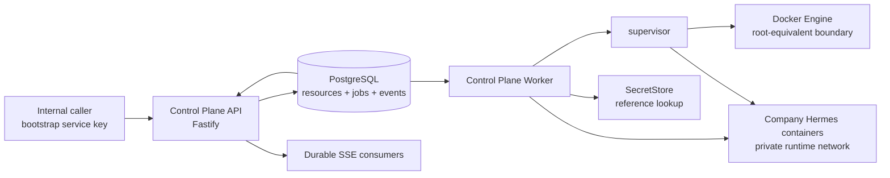

# Control Plane Runtime v1 Design

Status: Approved

Date: 2026-08-03

Scope: Internal single-node Control Plane runtime, durable company-container
provisioning, Profile routing, and one real asynchronous Hermes conversation.

Related decisions:

- [ADR 0001: Hermes Runtime Distribution Boundary](../../architecture/0001-hermes-runtime-distribution.md)
- [ADR 0002: Control Plane Runtime Topology](../../architecture/0002-control-plane-runtime-topology.md)
- [ADR 0003: Durable Execution and PostgreSQL Authority](../../architecture/0003-control-plane-durable-execution-and-storage.md)
- [ADR 0004: Internal API, Secret, and Streaming Boundaries](../../architecture/0004-control-plane-internal-api-security-and-streaming.md)
- [ADR 0005: Hermes Profile Bootstrap Without Container Exec](../../architecture/0005-hermes-profile-bootstrap-without-container-exec.md)

## 1. Purpose

The repository already owns a reproducible Hermes product image and stable
Control Plane Contracts v1. It does not yet have a running Control Plane that
can persist a company, create its isolated Hermes container, route to one of
its Profiles, execute a conversation, and expose durable events.

Runtime v1 closes that gap with the smallest production-shaped vertical slice:

1. accept one internal tenant-provisioning command;
2. persist the tenant identity graph and desired runtime state in PostgreSQL;
3. create and start the company's pinned Hermes container through a narrow,
   privileged Runtime Supervisor;
4. create a Conversation and asynchronous Agent Run for a selected Profile;
5. stream a real Hermes answer through durable ProductEvents and SSE;
6. recover queued work and event delivery after API, Worker, or client restart.

This milestone proves the backend control path. It is not a public user API and
does not implement login, entitlement sales, MCP tools, composite memory, or a
Web/Apple client.

## 2. Decision register

The following records preserve every option approved during the design review.
The selected option is normative; alternatives document why the boundary was
chosen and must not be silently reintroduced during implementation.

| ID | Topic | Accepted option | Rejected alternatives | Rationale |
| --- | --- | --- | --- | --- |
| D01 | Deployment | Single-node Docker Runtime; Mac + Colima for development and one Linux host for production | Remote Docker host; Kubernetes/multi-node from v1 | Delivers a real backend without designing distributed scheduling first; interfaces remain remote-agent compatible |
| D02 | Authority database | PostgreSQL; local Docker PostgreSQL and production Supabase PostgreSQL through standard PostgreSQL protocol | SQLite; JSON/in-memory | Multi-tenant constraints, transactions, durable jobs, audit, and concurrent workers require PostgreSQL semantics |
| D03 | Service framework | TypeScript + Fastify | NestJS; Python FastAPI | Reuses `@core-agent/contracts`, TypeBox, and JSON Schema without a second type source |
| D04 | API security | Internal-only API on loopback/private network with a bootstrap service key | Implement Identity in this milestone; public Bearer API | Keeps Runtime v1 closed until Identity can issue trusted request context |
| D05 | Vertical-slice completion | Provision company and Profiles, reach a healthy Hermes container, complete one real Profile conversation, persist events and audit | Container lifecycle only; all production Runtime features at once | Produces an observable product proof while keeping the milestone bounded |
| D06 | Conversation delivery | Asynchronous Agent Run plus durable SSE and cursor resume | Synchronous HTTP; WebSocket | Prevents long-request timeout and gives Web/Mac/iOS a stable future event protocol |
| D07 | Background execution | PostgreSQL worker jobs plus Transactional Outbox | Redis/BullMQ; in-process promises | Survives process restart and keeps resource, job, and event state atomic without another datastore |
| D08 | Secrets | Pluggable `SecretStore`; PostgreSQL stores only references and versions | Encrypted secret values in PostgreSQL; ordinary environment variables for all tenant secrets | Allows safe local files now and a cloud secret manager later without schema or API change |
| D09 | Database access | Kysely + `pg` + versioned SQL migrations | Drizzle; Prisma | Keeps PostgreSQL locking, CTE, constraint, and migration behavior explicit |
| D10 | Docker authority | Separate local Runtime Supervisor is the only process with Docker Socket access | Control Plane mounts Docker Socket; Docker CLI subprocesses | Docker access is root-equivalent and must be isolated behind an allowlisted protocol |
| D11 | Process boundary | Separate API, Worker, and Runtime Supervisor processes | Combine API and Worker; monolith with Docker access | Isolates request availability, long-running work, and root-equivalent host operations |
| D12 | Failure model | Desired/observed reconciliation, leased jobs, idempotent Supervisor operations, persistent event cursors | Treat HTTP completion or memory buffers as authority | API, Worker, or SSE disconnection must not lose or falsify work |
| D13 | HTTP/data scope | Narrow command/query API, explicit PostgreSQL tables, additive Message/Run Input contract extension | Generic CRUD for every resource; private unversioned prompt JSON | Avoids premature public administration APIs and prevents a second message protocol |
| D14 | Quality gate | Unit, real PostgreSQL, fake-dependency integration, and opt-in real Hermes E2E layers | Mock-only testing; real secrets or large Hermes image in CI | Keeps CI deterministic while retaining an explicit real-runtime proof |

## 3. Goals and non-goals

### 3.1 Goals

- Use the existing Tenant, Actor, Membership, Profile, RuntimeContainer,
  Conversation, Session, AgentRun, Task, ProductEvent, AuditEvent, ErrorEnvelope,
  and idempotency contracts as the wire authority.
- Support both contract-defined tenant modes:
  - B2B: one company container and one or more consultant Profiles;
  - B2C: one container and exactly one default student Profile.
- Keep every company's Hermes state in its own persistent volume.
- Keep company containers off public host ports.
- Keep Docker authority out of the API and Worker.
- Make provisioning commands, runtime commands, and Agent Runs idempotent.
- Persist ProductEvents before making them visible over SSE.
- Continue queued work after process restart.
- Ensure secrets never enter ordinary resource rows, events, errors, or logs.
- Run the same component topology in Mac development and Linux production.

### 3.2 Non-goals

The following are intentionally excluded and require later specifications:

- public login, Session Cookie, device authentication, and OAuth providers;
- Identity Runtime signing, Ed25519/JWS verification, key rotation, and revocation;
- Entitlement SKU, purchase, seat assignment, and Capability Pack activation;
- Policy Plugin, MCP Gateway, business Tools, and Human Approval execution;
- Composite Memory, Supabase business projections, and Honcho projection;
- Web, Mac, iOS, or other end-user UI;
- public OpenAPI and generated Swift client distribution;
- production use with real customer or student content before Identity,
  consent, retention, and data-governance specifications are accepted;
- multi-node scheduling, Kubernetes, and remote Runtime Agents;
- Hermes image upgrade, draining, rollback, and data-migration orchestration;
- arbitrary container exec, shell access, host mounts, or general Docker API;
- audit retention policy and regulatory export.

Image upgrade and rollback remain the next Runtime-only slice (`Runtime v1.1`)
and must be completed before treating the Control Plane Runtime phase as
production-complete.

## 4. System architecture



### 4.1 Control Plane API

The API is a TypeScript Fastify process. It:

- binds only to loopback or an explicitly configured private interface;
- authenticates the bootstrap service key before parsing tenant commands;
- validates request and response schemas with TypeBox/JSON Schema;
- resolves idempotency and optimistic concurrency;
- writes resources, internal jobs, outbox rows, and audit rows transactionally;
- returns `202 Accepted` for asynchronous provisioning and Run creation;
- serves resource queries and durable SSE event streams;
- never receives Docker Socket access;
- never returns secret values.

The API performs no long-running Docker or Hermes operation inside an HTTP
handler.

### 4.2 Control Plane Worker

The Worker is a separate TypeScript process built from the same workspace. It:

- claims leased jobs from PostgreSQL using `FOR UPDATE SKIP LOCKED`;
- performs runtime reconciliation and Agent Run execution;
- calls the Runtime Supervisor through its Unix Domain Socket;
- resolves a secret only immediately before the dependent operation;
- calls the selected Hermes Profile over a private container network;
- writes state transitions and ProductEvents in database transactions;
- renews or releases job leases and records retry state;
- never receives Docker Socket access.

Separating API and Worker prevents a long model stream or container probe from
starving request handling and lets either process restart independently.

### 4.3 Runtime Supervisor

The Runtime Supervisor is a small, privileged local process. It alone mounts or
otherwise receives access to the Docker Engine Socket. It exposes a versioned
Unix Domain Socket protocol and only these operations:

- `provision` from a complete server-derived `RuntimeSpec`;
- `start`;
- `stop`;
- `inspect`;
- `delete`, preserving the volume by default;
- a separate explicit volume-deletion command requiring the already-deleted
  runtime and a new operation identifier.

The Supervisor rejects:

- arbitrary Docker image names or mutable tags;
- images not present in the immutable repository lock;
- arbitrary host paths or caller-provided volume source paths;
- `exec`, shell, privileged mode, added capabilities, devices, host PID, or
  host network;
- arbitrary environment variables;
- containers without Core-Agent ownership and tenant labels;
- a request whose tenant, runtime, volume, image, or generation conflicts with
  an existing operation identifier.

Provisioning may launch one fixed, pinned Core-Agent initializer container. It
is not a general `exec` escape hatch. The initializer:

- runs before the Hermes gateway starts;
- mounts only the target company volume and server-derived read-only bootstrap
  files;
- has no network, Docker Socket, added capability, or arbitrary command;
- accepts one versioned RuntimeBootstrapBundle validated before launch and
  again inside the initializer;
- creates only the declared Hermes Profiles with bundled skills opted out;
- writes the approved description, model/provider settings, and profile `.env`
  files atomically with owner-only permissions;
- produces a non-secret manifest hash used by the Supervisor for idempotent
  adoption.

The product image also owns a fixed gateway entrypoint that reads the container
ingress key from a read-only secret file and exports it only inside the process
before starting Hermes. The key value is never placed in the Docker container
configuration environment, where `docker inspect` could reveal it.

Container names, network aliases, volume names, labels, and paths are derived
from validated opaque identifiers. A caller never supplies a Docker name or raw
filesystem path.

### 4.4 PostgreSQL

PostgreSQL is the authority for resources, desired state, durable work, events,
audit, and idempotency. Local development runs ordinary PostgreSQL through
Docker Compose. The production target is Supabase PostgreSQL, consistent with
the repository rule that durable business truth lives in Supabase.

The application uses the standard PostgreSQL protocol through `pg` and Kysely;
it does not depend on Supabase-specific client behavior. This preserves local
parity and allows controlled provider migration without weakening the
production Supabase target.

### 4.5 SecretStore

`SecretStore` is a port owned by the platform layer:

```ts
interface SecretStore {
  get(reference: SecretReference): Promise<SecretMaterial>;
}
```

The database stores only the opaque reference, purpose, version, status, and
timestamps. It never stores secret bytes.

The development adapter reads files under one configured secret root. The
canonical root must be owned by the runtime uid with exact `0700` permissions.
Every canonical ancestor through the filesystem root must be a directory owned
by either root or the runtime uid and must prohibit group/other writes. This is
a deployment precondition: untrusted workloads must not share the runtime uid,
because a cooperating same-uid process cannot be contained by Unix permission
checks. File names are derived from validated opaque IDs, resolved paths must
remain under that root, and files must have owner-only permissions (`0600`). On
Linux, the adapter opens the child through the held root directory descriptor;
on macOS it retains protected-ancestor and root-identity checks around the
child open and read. API clients cannot provide a raw path. A production
adapter may resolve the same reference from a cloud secret manager.

Secret material must be redacted from structured logs, Docker error messages,
dependency failures, ProductEvents, AuditEvents, and ErrorEnvelopes. The
runtime releases in-memory references as soon as the dependent call ends;
JavaScript cannot guarantee physical zeroization, so the design does not claim
that guarantee.

Hermes currently resolves named Profile secrets from each Profile's `.env`.
During provisioning, the fixed initializer copies only the required resolved
values into that tenant's isolated runtime volume with `0600` permissions. The
runtime volume is an operational secret projection, not the system of record;
PostgreSQL and the bootstrap bundle retain only references. Rotation must
replace the projection atomically and is deferred to Runtime v1.1.

The Worker resolves only the company Hermes ingress key needed to authenticate
the private multiplex API call. It never receives the model-provider credential;
that credential remains inside the Profile's runtime secret projection.

### 4.6 Provider catalog

Model endpoint URLs and allowed model identifiers are server-managed,
non-secret configuration. Provisioning selects a `provider_config_id`; it does
not submit an arbitrary base URL. Each provider entry contains:

- a stable provider configuration ID;
- an allowlisted HTTPS base URL;
- an allowlisted model ID set;
- a SecretStore reference for the provider credential;
- optional timeout and retry ceilings.

This prevents provisioning input from becoming an SSRF or arbitrary egress
mechanism. The existing development TokenHub endpoint and model can be one
managed catalog entry, not a client-controlled URL.

## 5. Deployment and network boundary

### 5.1 Development

Mac development uses Colima or a compatible Docker Engine and Docker Compose.
The topology includes PostgreSQL, API, Worker, Runtime Supervisor, and generated
company Hermes containers. Only the API's internal development port may bind to
`127.0.0.1`. PostgreSQL, Supervisor, and Hermes remain unexposed.

### 5.2 Production

Runtime v1 targets one Linux server:

- API and Worker run as unprivileged services;
- Runtime Supervisor runs with only the permissions needed to reach Docker;
- Worker and Supervisor communication uses a Unix socket with an explicit owner,
  group, and `0660` or stricter mode;
- Hermes containers join a private Core-Agent runtime network;
- Hermes API ports are not published to the host public interface;
- PostgreSQL connections to Supabase require TLS and a dedicated least-
  privilege database role;
- the public Web/API Gateway layer does not exist in this milestone.

## 6. Contract addendum required before Runtime implementation

The accepted Contracts v1 define Conversation, AgentRun, `message.delta`, and
`message.completed`, but they do not define the user input Message that starts a
Run. Runtime v1 must not hide prompts in an unversioned private JSON column.

Before implementing the Runtime, publish an additive `@core-agent/contracts`
minor release with:

### 6.1 Message resource

The new Message contract contains:

- resource metadata and positive `resource_version`;
- `message_id`;
- `tenant_id`;
- `conversation_id`;
- `run_id`;
- role `user | assistant`, marked as an extensible union for later tool roles;
- status `pending | streaming | completed | failed`;
- bounded content for completed user or assistant text;
- created and updated UTC-Z timestamps from resource metadata.

No raw provider payload, hidden model reasoning, unrestricted metadata, secret,
or Tool arguments are permitted.

### 6.2 Create Agent Run request

The request contains:

- `schema_version`;
- `idempotency_key` and canonical `payload_hash`;
- `client_request_id`;
- `input_message` with an opaque `client_message_id` correlation value and
  bounded text;
- optional `parent_run_id` for an explicit retry.

The server derives Message resource metadata, `message_id`, `tenant_id`,
`conversation_id`, `run_id`, role, and status. The client-generated message ID
is only an idempotent correlation value and is not a server resource ID. Tenant
and Profile are resolved from the authenticated scope and immutable
Conversation binding. A client cannot change them in the Run request.

### 6.3 Additive message event

Add `message.created` for the accepted user Message. Existing
`message.delta` and `message.completed` remain the assistant output stream.
The ProductEvent union is explicitly extensible, so this is an additive event
branch rather than a rewrite of accepted v1 semantics.

### 6.4 Compatibility publication

The contract change must:

- bump the package and exported version consistently;
- update `CHANGELOG.md` and `compatibility-change.json`;
- generate schemas and anonymous valid/invalid fixtures;
- pass existing compatibility and history gates;
- append a new immutable `compat/v1/releases/<package-version>` snapshot;
- never edit the initial files directly under `compat/v1`.

## 7. Internal API

All endpoints below are internal and versioned under `/internal/v1`. They use
JSON unless specified otherwise and return the existing resource schemas or
ErrorEnvelope.

### 7.1 Health

- `GET /health/live`: process event loop is alive; no dependency check.
- `GET /health/ready`: migrations are current, PostgreSQL is reachable, and
  required managed configuration is valid. A transient Supervisor or Hermes
  outage does not make the API process unready but is reported in dependency
  detail without secrets.

### 7.2 Tenant provisioning

- `POST /internal/v1/tenant-provisioning`

The request contains a contract-valid business IdentityGraph, one server-
allowed provider configuration reference, required secret references, and the
desired pinned runtime image reference. It creates the tenant facts, initial
RuntimeContainer in `requested`, one internal provisioning job, an
idempotency record, an outbox row, and a pending AuditEvent in one transaction.

The API adds a server-managed provisioner service Actor and tenant-scoped active
admin Membership for bootstrap auditing. The request cannot supply or override
that identity. Real human authentication is not implied.

The response is `202 Accepted` with the Tenant and RuntimeContainer resource
references. Repeating the same idempotency key and payload returns the original
result; a different payload returns `IDEMPOTENCY_CONFLICT`.

### 7.3 Runtime query and commands

- `GET /internal/v1/tenants/:tenant_id/runtime`
- `POST /internal/v1/tenants/:tenant_id/runtime-commands`

Runtime commands are `start`, `stop`, `restart`, and `delete`. They require an
idempotency key and `expected_resource_version`. Delete preserves the volume.
Volume destruction is not exposed by this HTTP milestone; it remains an
operator-only Supervisor action until a later approval design exists.

### 7.4 Conversations and Runs

- `POST /internal/v1/conversations`
- `POST /internal/v1/conversations/:conversation_id/runs`
- `GET /internal/v1/runs/:run_id`
- `GET /internal/v1/conversations/:conversation_id/events`

Conversation creation binds one active tenant, Profile, creator service Actor,
and optional Student/Case references. It also creates one active contract
Session with a server-generated opaque `hermes_session_ref`. The binding is
immutable under the existing contract invariants.

Run creation derives the server Message and Run identifiers, then writes the
user Message, queued AgentRun, internal execution job,
`message.created`, `run.queued`, outbox rows, idempotency record, and AuditEvent
in one transaction. It returns `202 Accepted` with the AgentRun.

The event endpoint serves `text/event-stream`. It accepts a sequence cursor via
`Last-Event-ID` or an equivalent explicit `after_sequence` query on the first
connection. PostgreSQL event rows, not an in-memory buffer or notification, are
authoritative.

## 8. PostgreSQL data model

SQL migrations are versioned, reviewed artifacts. Production deployment runs
migrations as a dedicated release step; application startup checks the schema
version and refuses readiness if it is behind or ahead.

### 8.1 Resource tables

- `tenants`
- `actors`
- `memberships`
- `profiles`
- `runtime_containers`
- `conversations`
- `sessions`
- `agent_runs`
- `messages`

Columns mirror the contract fields where a resource exists. Contract JSON is
not stored as the only representation: important IDs, states, versions, and
timestamps are typed columns with database constraints.

Every tenant-owned primary or unique lookup includes `tenant_id`. Composite
foreign keys prevent a row in one tenant from referencing a Profile,
Conversation, Run, or Runtime in another tenant.

### 8.2 Reliable execution tables

- `worker_jobs`: internal job kind, opaque payload reference, status, attempt,
  lease owner, lease expiry, next attempt time, last redacted error, timestamps;
- `idempotency_records`: contract-defined tenant/key/hash/result mapping;
  `expires_at` is retention/operations metadata and never permits reuse of an
  existing tenant/key tombstone;
- `outbox`: durable event reference, delivery target, attempts, next attempt,
  and delivered timestamp.

Infrastructure jobs are not exposed as the contract `Task` resource. `Task`
belongs to Agent execution and requires an origin Run; provisioning and event
dispatch remain internal worker jobs.

### 8.3 Event and audit tables

- `product_events`: complete validated ProductEvent, stream ID, stream sequence,
  event ID, associations, timestamp, and JSON payload;
- `audit_events`: complete validated AuditEvent and indexed associations;
- `stream_cursors`: optional durable consumer positions for server-managed
  consumers, not client SSE cursors.

Constraints include unique `event_id` and unique
`(tenant_id, stream_id, sequence)`. Sequence allocation is performed inside the
same transaction that writes the associated state change.

### 8.4 Secret metadata

`secret_references` contains only reference ID, tenant ID where applicable,
purpose, version, status, and timestamps. A migration or test must fail if a
column resembling secret material is added without an approved ADR.

## 9. Durable processing and reconciliation

### 9.1 Job claim

Workers claim eligible rows using a short transaction and
`FOR UPDATE SKIP LOCKED`, set a lease owner and expiry, then execute external
work outside the transaction. Lease duration and heartbeat are bounded. On
process failure, another Worker may reclaim an expired lease.

### 9.2 Retry policy

- validation, authorization, state conflict, and Supervisor rejection are
  permanent failures;
- connection refusal, dependency unavailability, and safe pre-effect timeout
  are retryable with bounded exponential backoff and jitter;
- each job has a maximum attempt count and redacted terminal failure summary;
- an Agent Run is not automatically replayed after any assistant content or
  external effect has begun;
- an explicit Agent retry creates a new `run_id` and points `parent_run_id` to
  the failed Run, as required by the existing contract.

### 9.3 Runtime reconciliation

RuntimeContainer keeps desired and observed state separate. The Worker compares
PostgreSQL desired state with Supervisor inspection results and advances only
through allowed contract transitions.

The Supervisor operation is idempotent on `operation_id` plus a canonical
request hash. Existing Docker resources are adopted only when Core-Agent labels,
tenant, runtime ID, image digest, generation, volume, network, and request hash
match. Mismatch fails closed; the Supervisor never mutates an unrelated
container to make the request appear successful.

Health must pass before observed state becomes `ready`. A failed health probe
may mark health degraded or unhealthy, but it cannot silently change desired
state.

### 9.4 Transactional Outbox

Resource transitions, ProductEvents, AuditEvents, and outbox rows are committed
together. A dispatcher may use PostgreSQL `LISTEN/NOTIFY` as a wake-up hint, but
notifications are not durable. Dispatchers always query undelivered rows, so a
missed notification or restart cannot lose an event.

The dispatcher permits at most 10 notification attempts. In the same
transaction and before ordinary claims, it terminalizes pending exhausted rows
whose lease is absent or expired as `failed`, clears the lease, and records a
fixed redacted-safe summary using the database clock. It neither sends a
recovery notification nor creates attempt 11, and it does not disturb a live
tenth-attempt lease. A successful notification with a lost durable delivered
acknowledgement may later follow this failure path; ProductEvent database
polling remains authoritative and discoverable.

## 10. Provisioning flow

1. API authenticates the bootstrap key, derives the provisioner service
   identity, and validates the business IdentityGraph,
   provider reference, secret references, image digest, and idempotency fields.
2. One PostgreSQL transaction writes identity facts, RuntimeContainer in
   `requested`, idempotency result, provisioning job, outbox, and AuditEvent.
3. Worker claims the job and transitions observed state to `provisioning`.
4. Worker creates a server-derived RuntimeSpec and sends `provision` to the
   Supervisor.
5. Supervisor validates the entire allowlist, creates or adopts the exact
   volume/network, resolves required secret references, and runs the fixed
   no-network initializer against the company volume.
6. Supervisor starts the gateway with a file-backed ingress key. Worker probes
   each named Profile through `/p/<hermes_profile_ref>/v1/chat/completions` over
   the private network.
7. On success, one transaction changes the Runtime to `ready`, health to
   `healthy`, activates the tenant/Profile facts allowed by the provisioning
   workflow, and writes events/audit.
8. On permanent failure, Runtime becomes `failed` with a bounded redacted
   summary; on retryable failure, the job schedules the next attempt without
   falsely reporting readiness.

## 11. Agent Run and SSE flow

1. API authenticates the internal caller and validates Conversation scope,
   Profile status, active Session, Runtime readiness, request idempotency, and
   retry parent.
2. One transaction creates the user Message, queued AgentRun, execution job,
   ProductEvents, AuditEvent, idempotency result, and outbox rows.
3. Worker claims the job and atomically changes the Run to `running` with
   `run.started`.
4. Worker resolves the company Hermes ingress key and calls the selected
   Hermes Profile at `/p/<hermes_profile_ref>/v1/chat/completions` over the
   private runtime network. It supplies the server-controlled
   `X-Hermes-Session-Id` derived from `hermes_session_ref`; Hermes resolves the
   provider credential inside the selected Profile scope.
5. Assistant deltas become ordered `message.delta` ProductEvents. A completed
   assistant Message and `message.completed` are written before
   `run.completed` and Run success.
6. SSE reads persisted events after the client's sequence cursor. Notification
   only wakes the stream; a database query supplies the bytes.
7. Client disconnection does not cancel the Run. Reconnection resumes from the
   last acknowledged sequence.
8. Hermes interruption produces a redacted terminal `run.failed` if automatic
   retry is unsafe. A caller may explicitly create a new child Run.

The Hermes Session provides in-runtime conversational continuity only. Runtime
v1 does not issue `X-Hermes-Session-Key` for durable cross-session memory and
does not claim to implement the later Composite Memory authority, ACL, or
consent model.

## 12. Error model

Every JSON error uses the existing ErrorEnvelope. Runtime v1 adds only stable,
additive error codes required for machine handling; it does not expose provider
messages as public codes.

| HTTP | Category | Examples | Retryable |
| --- | --- | --- | --- |
| 400 | `validation` | invalid schema, invalid cursor, invalid transition | No |
| 401 | `authentication` | missing or invalid bootstrap key | No |
| 404 | `authorization` or `validation` | resource absent or hidden by tenant scope | No |
| 409 | `conflict` | idempotency conflict, version conflict, operation conflict | No until caller changes input |
| 503 | `dependency` or `unavailable` | PostgreSQL, Supervisor, or Hermes unavailable | Usually yes |
| 504 | `timeout` | dependency deadline exceeded before unsafe replay boundary | Conditional |
| 500 | `internal` | unexpected implementation failure | No by default |

Recommended additive codes include:

- `INVALID_REQUEST`;
- `UNAUTHENTICATED`;
- `RESOURCE_NOT_FOUND`;
- `RESOURCE_VERSION_CONFLICT`;
- `INVALID_STATE_TRANSITION`;
- `RUNTIME_NOT_READY`;
- `SUPERVISOR_REJECTED`;
- `DEPENDENCY_UNAVAILABLE` (already present);
- `DEPENDENCY_TIMEOUT`;
- `INTERNAL_ERROR` (already present).

The implementation must decide whether a hidden cross-tenant resource returns
404 or a generic authorization response consistently; it must never confirm
the existence of another tenant's resource.

After Run creation, business failure is represented by durable Run/ProductEvent
state. An SSE transport disconnect is not a Run failure.

## 13. Security invariants

The following are release-blocking invariants:

1. All tenant resource reads, writes, joins, unique constraints, jobs, events,
   and audit queries carry tenant scope.
2. API and Worker containers or services have no Docker Socket.
3. Supervisor cannot execute a shell or accept arbitrary Docker options.
4. Hermes images are pinned by platform digest and selected from managed lock
   data.
5. Hermes containers use private networking and no public host port.
6. API input cannot supply a model base URL, Docker name, host path, network,
   environment variable name, or secret path.
7. Secret bytes never appear in Docker configuration environment, PostgreSQL
   rows, ErrorEnvelope, ProductEvent,
   AuditEvent, structured log, trace attribute, or test fixture.
8. Bootstrap key comparison hashes both candidate and configured values to
   fixed-length SHA-256 digests and compares them with a constant-time primitive;
   the original key is supplied out of band.
9. The bootstrap service identity has only the internal actions required by
   this milestone and is never presented as a human consultant/student login.
10. State transitions use the existing contract matrices; terminal Runs and
    deleted resources cannot be overwritten.
11. `resource_version` and expected version prevent lost updates.
12. Dependency and Docker errors are reduced to allowlisted, bounded summaries
    before persistence.

## 14. Testing strategy

### 14.1 Unit tests

- request validation and ErrorEnvelope mapping;
- constant-time bootstrap authentication behavior;
- provider catalog and SecretStore path validation;
- secret redaction and forbidden-key scans;
- job lease, backoff, and retry classification;
- runtime and Run state transitions;
- Supervisor allowlist and canonical operation hashing;
- fixed initializer bundle validation, no-network/no-exec configuration, and
  deterministic Profile manifest generation;
- Docker resource-name and label derivation;
- event sequence and SSE cursor handling;
- idempotency and resource-version conflicts.

### 14.2 Real PostgreSQL tests

CI starts PostgreSQL as a service and verifies:

- migrations from an empty database and schema-version refusal;
- database constraints and composite tenant foreign keys;
- concurrent idempotency requests;
- concurrent job claim with `SKIP LOCKED`;
- lease expiry and reclaim;
- atomic resource/job/event/audit/outbox writes;
- unique stream sequence allocation;
- cross-tenant reads and writes fail closed;
- PostgreSQL dump and query results contain no synthetic test secret.

Tests use anonymous synthetic tenants, actors, Profiles, and secrets.

### 14.3 Integration tests

Use a fake Runtime Supervisor Unix server and a fake streaming Hermes endpoint
to test deterministically:

- full provisioning request through `ready`;
- Supervisor rejection and retryable unavailability;
- full Conversation/Run through SSE completion;
- API restart with event resume;
- Worker termination with lease reclaim;
- Hermes disconnect before and after the unsafe replay boundary;
- duplicate request replay without duplicate container or Run;
- errors and logs contain no fake secret.
- Docker inspection data contains no fake secret and no arbitrary command;

### 14.4 Real local E2E

An explicit smoke test uses real Docker, the pinned Hermes image, PostgreSQL,
Runtime Supervisor, and user-provided provider secret. It is not part of normal
CI because the image is large and no real model credential belongs in GitHub
Actions.

The smoke uses a synthetic tenant, Profile, and prompt. Runtime v1 is not
authorized for real customer or student data before the later Identity,
consent, retention, and data-governance specifications are implemented.

The smoke test must print only resource IDs, states, event types, and redacted
summaries. It must never print the user prompt if the prompt might contain
personal data, the provider key, the Hermes ingress key, or raw dependency
headers.

## 15. Acceptance criteria

Runtime v1 is complete only when all of the following evidence exists:

1. An empty PostgreSQL database migrates to the expected version and API
   readiness succeeds.
2. Repeating the same tenant-provisioning command creates exactly one tenant,
   identity graph, RuntimeContainer, volume, and company Hermes container.
3. The Runtime transitions from `requested` through allowed states to `ready`
   and `healthy`; the container exposes no public host port, all requested
   Profiles exist, and Docker inspection exposes no secret value.
4. A caller selects an active Profile, creates a Conversation, submits one user
   Message, and receives `202` with an AgentRun.
5. SSE returns ordered persisted `message.created`, `run.queued`, `run.started`,
   assistant message events, and `run.completed`.
6. Restarting API or Worker does not lose the Run; an SSE client resumes from a
   persisted sequence cursor.
7. Cross-tenant access, forged Profile binding, invalid state transition,
   unsafe image, dangerous Docker option, raw secret path, and repeated key with
   a different payload all fail closed.
8. Database export, ProductEvents, AuditEvents, ErrorEnvelopes, and logs contain
   no test secret.
9. Contract compatibility, TypeScript build, unit, PostgreSQL, integration,
   Compose configuration, and static security gates pass in CI.
10. The opt-in real Hermes smoke receives a non-empty assistant response through
    the selected Profile without exposing credentials.

## 16. Delivery sequence

Implementation planning must preserve this dependency order:

1. additive Message/Run Input contract release and compatibility snapshot;
2. PostgreSQL migrations, Kysely types, repositories, and transaction helpers;
3. domain services for idempotency, transitions, jobs, events, and redaction;
4. fake Supervisor protocol and Supervisor allowlist tests;
5. real Runtime Supervisor Docker adapter;
6. Fastify internal API and bootstrap authentication;
7. Worker provisioning/reconciliation path;
8. Worker Agent Run and fake Hermes streaming path;
9. durable SSE and cursor recovery;
10. Compose/CI integration and real local Hermes smoke.

No task may grant Docker Socket access to the API or Worker to simplify an
intermediate test. No task may store a secret value in PostgreSQL as a temporary
shortcut.

## 17. Traceability policy

This specification records the complete accepted Runtime v1 design. The ADRs
record the stable architectural decisions and their rejected alternatives.

Future changes must:

- cite the affected decision ID (`D01` through `D14`);
- update this specification or add a superseding specification;
- add or supersede an ADR when changing a long-lived boundary;
- preserve the original file and mark it superseded rather than rewriting
  history to make the old decision disappear;
- include compatibility and migration consequences before implementation.

The ignored Visual Companion session is not an authoritative artifact. These
committed Markdown documents are the durable source for later review.
