# Core Agent B2B Web Chat Design

**Status:** Visual direction approved; written specification awaiting review  
**Date:** 2026-08-06  
**Primary surface:** B2B consultant Web workspace  
**Future surfaces:** macOS and iPhone clients

## 1. Decision record

The approved product decisions are:

1. The first graphical client targets **B2B consultants**, not the student self-service flow.
2. The consultant identity is bound by authentication. The ordinary interface does not
   offer a consultant Profile switcher.
3. The left-side information architecture is **students and their conversations**.
4. The selected desktop layout is **A: a native three-column consultant workspace**.
5. The iPhone counterpart uses hierarchical navigation rather than squeezing desktop
   columns into a phone viewport.
6. Runtime v1 remains the execution authority. The graphical client never calls Hermes
   or the model provider directly.

The approved visual references are:

- [Desktop consultant workspace](../../design/core-agent-web/consultant-workspace-desktop.png)
- [iPhone focused conversation](../../design/core-agent-web/consultant-workspace-iphone.png)

The desktop concept uses multiple demo student rows to make the selected information
architecture visible. The executable milestone intentionally exposes only one live
synthetic demo student. Additional students are not rendered as if they were usable
until an authenticated student/domain contract exists.

The design language follows the supplied
[Apple design analysis](https://github.com/VoltAgent/awesome-design-md/blob/main/design-md/apple/DESIGN.md)
and
[Apple fluid-interface skill](https://github.com/emilkowalski/skills/blob/main/skills/apple-design/SKILL.md),
adapted to a professional application rather than copied from an Apple marketing page.

## 2. Goal and scope

### 2.1 Goal

Provide a polished, responsive Web client that proves a consultant can start the local
Core Agent system, create a Conversation, send multiple synthetic prompts through the
real Control Plane, receive streamed Hermes responses, create a fresh Conversation,
and restart the API/Worker path without exposing internal credentials to the browser.

The same information hierarchy, design tokens, client-facing event semantics, and
navigation model must be usable by later macOS and iPhone clients.

### 2.2 Included

- A React and TypeScript Web application in the existing monorepo.
- A local, loopback-only Client Gateway/BFF that owns the privileged Control Plane
  connection and serves the built Web assets.
- One process-owned synthetic managed Runtime session using the existing runtime-v1
  lifecycle boundary.
- Real Conversation creation, Agent Run creation, assistant delta streaming, `/new`
  equivalent UI, and exact API/Worker restart.
- Desktop, compact desktop/tablet, and phone responsive layouts.
- Loading, empty, streaming, success, restart, disconnected, and bounded-error states.
- Keyboard navigation, visible focus, screen-reader status, Dynamic Type-compatible
  layout, reduced motion, reduced transparency, and increased contrast fallbacks.
- Automated component, gateway, contract, responsive, accessibility, and browser tests.

### 2.3 Excluded

- Production user authentication, invitations, company administration, or billing.
- Real students, customer data, student data, or production tenant selection.
- EduApply, IELTS, housing, auto-apply, MCP, Skill, or entitlement integration.
- File uploads, voice, image generation, citations, approvals, or tool-result panels.
- A production conversation search/history API.
- Native macOS or iOS implementation in this milestone.
- Direct browser access to the bootstrap key, API ingress credential, provider key,
  Docker socket, Supervisor socket, or internal Control Plane routes.

Only anonymous synthetic prompts are permitted in this milestone. The single visible
student identity is an explicit demo alias, not a real Student resource.

## 3. Chosen architecture

### 3.1 Technology

- **Client:** React, TypeScript, and Vite.
- **Client Gateway:** a focused Node.js/Fastify server within the same workspace.
- **Streaming:** `fetch()` response streaming with bounded SSE frames.
- **Styling:** repo-owned CSS design tokens and component styles; no runtime CSS-in-JS.
- **Icons:** a small consistent SVG set, using `currentColor` and Apple-like optical
  weight without using the Apple logo.
- **Testing:** Node test runner for server/contracts, component tests for client state,
  and browser tests for responsive and end-to-end behavior.

React and Vite keep the client portable and avoid coupling the future native apps to a
Web framework. Fastify matches the existing Control Plane implementation and provides
explicit request limits and security hooks.

### 3.2 Runtime relationship

```mermaid
flowchart LR
  Browser["React consultant workspace"]
  Gateway["Loopback Client Gateway"]
  Session["Managed Runtime session"]
  API["Control Plane API ingress"]
  Worker["Control Plane Worker"]
  Supervisor["Runtime Supervisor"]
  Hermes["Managed Hermes Runtime"]
  Provider["Configured model provider"]

  Browser -->|"same-origin client protocol"| Gateway
  Gateway -->|"server-side operations"| Session
  Session --> API
  API --> Worker
  Worker --> Supervisor
  Supervisor --> Hermes
  Hermes --> Provider
```



The Web command enters `runManagedRuntimeSession()` and keeps its `use` callback alive
for the lifetime of the Client Gateway. The managed session provisions one synthetic
Tenant, Profile, and Runtime before the browser is accepted. Normal process exit,
`SIGINT`, or `SIGTERM` closes the HTTP server and then enters the existing ordered
runtime cleanup path.

The browser never receives internal resource credentials or direct ingress authority.
It receives only bounded UI identifiers created by the Gateway.

### 3.3 Local security boundary

The first Web demo is local-only and must:

- bind only to `127.0.0.1`;
- disable CORS and reject unexpected `Host`, `Origin`, and cross-site fetch metadata;
- set a random process-local session cookie with `HttpOnly`, `SameSite=Strict`, and a
  bounded lifetime;
- require a separate in-memory CSRF value for mutations;
- apply small body/header limits and the existing 1–4000 character message policy;
- never render secrets into HTML, JavaScript, logs, errors, URLs, or browser storage;
- keep transcripts in browser/process memory only, while the Control Plane remains the
  sole durable message authority;
- return stable public error codes without raw provider, Docker, database, or internal
  exception content.

This is a development trust boundary, not production B2B authentication. A future
production Client Gateway will replace the local session bootstrap with company login
and map the authenticated consultant to one tenant, membership, and Profile.

## 4. Client protocol

The Client Gateway owns a narrow same-origin `/client/v1` interface:

| Operation | Purpose |
| --- | --- |
| `GET /client/v1/bootstrap` | Return sanitized Runtime readiness, demo consultant/student aliases, conversation summaries held by this process, and the CSRF value. |
| `POST /client/v1/conversations` | Create one real Control Plane Conversation and return a bounded UI conversation identity. |
| `POST /client/v1/conversations/:id/runs` | Validate one synthetic message, create one real Agent Run, and stream assistant deltas plus one terminal frame. |
| `POST /client/v1/runtime/restart` | Restart only the exact API and Worker services, wait for readiness, and return a stable completion state. |
| `GET /client/v1/health` | Return only local Gateway/session readiness for browser recovery. |

The streaming response has an allowlisted frame vocabulary:

- `run.started`
- `message.delta`
- `message.completed`
- `run.completed`
- `run.failed`

Each frame is bounded in size. The client ignores unknown fields and fails closed on an
unknown frame type, mismatched Conversation/Run identity, invalid sequence, excessive
event count, or excessive aggregate bytes.

The Gateway maintains an in-memory mapping from UI conversation identities to exact
Control Plane Conversation identities. It never accepts Tenant, Profile, Runtime,
provider, image, Compose project, or internal Conversation identifiers from the
browser.

## 5. Interface design

### 5.1 Desktop composition

At wide desktop sizes the workspace contains four visible regions:

1. **Global navigation rail** — 56px, containing the Core Agent mark, the active
   student/conversation destination, and Settings only for supported local actions. It
   does not show inert Library, MCP, Skill, or domain-product destinations.
2. **Student and conversation sidebar** — approximately 272px, containing the explicit
   demo student alias, recent Conversations, a search affordance, and New Conversation.
3. **Conversation canvas** — the flexible primary region. Message content is limited to
   a readable measure, while the composer remains anchored to the bottom safe area.
4. **Student context inspector** — approximately 280px, collapsible, showing only
   clearly labelled synthetic demo context and unavailable-capability states.

The inspector is secondary. Closing it expands the conversation canvas; reopening it
must originate from the inspector button and follow the same path in reverse.

### 5.2 Responsive composition

- **1180px and wider:** rail, student sidebar, conversation, and inspector can coexist.
- **834–1179px:** inspector becomes an anchored overlay; the rail and student sidebar
  remain visible when space allows.
- **641–833px:** global navigation collapses; student/conversation navigation becomes a
  leading pane or sheet, leaving the conversation as the main surface.
- **640px and narrower:** use a NavigationStack: Students → Conversations → focused
  Conversation. Student context opens from the title as an anchored sheet.

The mobile client is not a shrunken desktop. Touch targets are at least 44×44px, the
composer respects safe areas, and secondary data never pushes the transcript below a
usable width.

### 5.3 Component ownership

```text
ConsultantWorkspace
├── GlobalNavigationRail
├── StudentConversationSidebar
│   ├── DemoStudentHeader
│   └── ConversationList
├── ConversationWorkspace
│   ├── ConversationHeader
│   ├── Transcript
│   │   ├── AssistantTurn
│   │   └── ConsultantTurn
│   └── MessageComposer
├── StudentContextInspector
└── ResponsiveStudentNavigation
```

Data access is isolated behind a `ClientGatewayPort`. Components do not build request
headers, parse SSE, or know internal Control Plane identities. The top-level workspace
owns navigation and selected Conversation state; the transcript owns ordered frame
reduction; the composer owns draft text and validation only.

### 5.4 Visual system

- **Canvas:** `#ffffff`.
- **Secondary canvas:** `#f5f5f7`.
- **Primary ink:** `#1d1d1f`.
- **Muted ink:** `#6e6e73` / `#86868b` according to contrast role.
- **Action color:** only `#0066cc`; `#2997ff` is reserved for dark surfaces if a dark
  surface is introduced later.
- **Typography:** `-apple-system`, `BlinkMacSystemFont`, `SF Pro Text`, `PingFang SC`,
  `system-ui`, `sans-serif`. Body text is 17px with approximately 1.47 line height;
  display and section titles use weight 600, not 700.
- **Structure:** hairline dividers and surface changes, not card shadows.
- **Radii:** 8px compact controls, 18px utility surfaces, full pill only for a primary
  action, and circular 44px icon controls.
- **Elevation:** no shadow on cards, buttons, text, navigation, or composer. Frosted
  material is used only when navigation, composer, or inspector floats over content.
- **Decoration:** no gradients, glows, stock imagery, dashboard filler, fake metrics,
  or generic card grid.

Assistant content uses an open editorial treatment with a small identity cue. The
consultant turn uses a restrained neutral surface or edge marker rather than copying
iMessage-style blue bubbles and delivery receipts.

### 5.5 Motion and feedback

- Press feedback begins on pointer/touch down with a restrained scale change.
- Inspector, sheets, and navigation transitions use critically damped, interruptible
  motion with a response around 0.3–0.4 seconds and no decorative bounce.
- Entry and exit use the same spatial path and stay anchored to the triggering control.
- Streaming state uses content and status feedback, not an infinite decorative loader.
- `prefers-reduced-motion` replaces spatial movement with a short cross-fade.
- `prefers-reduced-transparency` replaces blur with an opaque high-contrast surface.
- `prefers-contrast: more` strengthens surfaces and focus rings without adding a second
  accent color.

## 6. Product flow

### 6.1 Startup

1. The Web host validates the same protected runtime environment as the terminal chat.
2. The managed Runtime session reaches `ready`.
3. The Client Gateway starts on loopback and serves the Web application.
4. The browser loads sanitized bootstrap state.
5. If no Conversation exists, the Gateway creates one real Conversation and the UI
   displays the empty focused state.

### 6.2 Sending a message

1. The composer validates non-empty synthetic content within 4000 characters.
2. The user message appears optimistically with a local pending state.
3. The Gateway creates the real Agent Run and begins its bounded stream.
4. The transcript appends matching assistant deltas in sequence.
5. `message.completed` finalizes the assistant turn.
6. `run.completed` restores the ready state and announces completion accessibly.

The composer remains editable while a Run is streaming, but a second send is not
admitted until the active Run becomes terminal. This preserves the user's draft without
violating the Control Plane's one-active-Run Conversation rules.

### 6.3 New Conversation

New Conversation creates a distinct real Control Plane Conversation and selects it. It
does not delete or mutate earlier Conversations. The UI never implements this by
clearing only the visible transcript.

### 6.4 Restart

Restart is an explicit utility action. The UI shows a bounded restarting state, calls
the exact API/Worker restart operation, waits for readiness, then preserves the selected
Conversation and allows the next Run. It never restarts Hermes, Supervisor, PostgreSQL,
or unrelated containers.

## 7. Failure and recovery

- Validation errors remain inline at the composer and do not create a Run.
- Network loss or browser stream cancellation never silently resubmits a message.
- A failed Run keeps the user turn visible, shows a stable error explanation, and
  offers an explicit retry that creates a new idempotency identity.
- A disconnected Gateway exposes a reconnect action and does not pretend Hermes is
  offline when only the browser connection failed.
- Restart failure leaves the current Conversation selected and reports a bounded
  failure state.
- Navigating away may abort browser consumption but never claims the server-side Run
  was cancelled. Run cancellation is excluded until a Control Plane cancellation
  contract exists.
- Raw error bodies, provider content, secrets, internal IDs, and transcript text never
  enter logs or public error details.

## 8. Cross-platform continuity

The Web application establishes a shared product language, not a WebView requirement.

- macOS can map the rail/sidebar/canvas/inspector model to `NavigationSplitView`.
- iPhone can map student/conversation hierarchy to `NavigationStack` and student
  context to a native Sheet.
- The platform-neutral `ClientGatewayPort` concepts—bootstrap, create Conversation,
  stream Run, restart, and health—can later be published as authenticated client
  contracts for Swift clients.
- Tokens are named by semantic role rather than CSS implementation so SwiftUI can own
  native equivalents.
- Platform conventions override pixel identity: desktop favors persistent context and
  keyboard use; iPhone favors focused touch flows and safe-area controls.

## 9. Alternatives considered

### 9.1 Direct browser access to Control Plane

Rejected. The current internal API requires privileged bootstrap authority. Shipping
that authority to JavaScript, local storage, or browser request configuration would
break the runtime security boundary.

### 9.2 Next.js full-stack application

Not selected for the first client. It supplies a convenient server boundary but adds a
larger framework and deployment model before the product needs routing, server
rendering, or public SEO. React/Vite plus a focused Gateway matches the existing Node
workspace and keeps the client portable.

### 9.3 Pure static mock client

Rejected. It would validate appearance but not the real Hermes interaction, restart,
streaming, or cleanup lifecycle that this milestone exists to prove.

## 10. Verification and acceptance

The implementation is accepted only when all of the following are demonstrated:

1. No bootstrap, ingress, provider, Docker, or Supervisor credential appears in the
   client bundle, browser storage, network response, logs, test evidence, or Git.
2. The Web host provisions and cleans one exact synthetic managed Runtime using the
   existing lifecycle boundary.
3. A real first Run streams a non-empty Hermes response into the UI.
4. A follow-up in the same Conversation succeeds.
5. New Conversation creates and selects a distinct real Conversation.
6. API/Worker restart preserves the current Conversation and the following Run succeeds.
7. Desktop, compact desktop/tablet, and phone layouts have no clipped content or
   horizontal overflow.
8. Keyboard navigation, focus visibility, screen-reader status, reduced motion,
   reduced transparency, and increased contrast are verified.
9. The rendered desktop and phone screenshots are compared directly with the approved
   concept images; material visual mismatches are corrected before handoff.
10. Root unit/check gates and new Web/Gateway/browser tests pass from a clean checkout.
