# Conversation Reliability v1 Design

**Status:** Implemented; deterministic verification passed; real-provider acceptance pending
**Date:** 2026-08-07  
**Primary surface:** B2B consultant Web workspace  
**Future surfaces:** student Web, iPhone, and macOS clients

## 1. Decision record

The approved product and architecture decisions are:

1. Conversation Reliability v1 is the next milestone before MCP, Skill, Identity,
   or entitlement work.
2. A failure after Agent execution has been dispatched is never replayed
   automatically. A user may explicitly create a related replacement Run.
3. This milestone does not switch model providers automatically.
4. Internal diagnostics, public client reasons, and localized UI copy are separate
   layers. Technical names and provider details are not user-facing content.
5. A failed reply with durable partial content keeps that content and clearly marks
   it as incomplete. A failed reply with no content does not leave an empty assistant
   bubble.
6. The system records a structured, allowlisted failure code. Raw provider bodies,
   exception text, credentials, internal URLs, and model output never become failure
   metadata.
7. The Browser, iPhone, and macOS clients share public reason semantics but own their
   localized presentation dictionaries.
8. A retry is a new Agent Run with `parent_run_id` referencing the failed Run. The
   failed Run and its audit history remain immutable.
9. Hermes extension follows the repository's plugin-first rule. The pinned Hermes
   plugin surfaces do not provide a guaranteed terminal provider-error hook for every
   abnormal turn, so a narrow, reviewed product-image overlay is permitted only for
   the managed gateway error projection described here. No general Hermes fork is
   introduced by this milestone.

## 2. Context and problem

The existing Web milestone proves the real path from Browser through the Client
Gateway, Control Plane, Worker, managed Hermes Runtime, and configured model provider.
It deliberately collapses every streamed Run failure into `CLIENT_RUN_FAILED`, and the
transcript renders the same `回复未完成。` message for every failure.

The motivating incident reached the Worker and was durably marked as dispatched. The
managed Hermes container remained healthy, but Hermes emitted an SSE error frame with
no assistant text after the configured provider returned a temporary service failure.
Runtime Core did not recognize the error frame as a structured failure, so the Run
became the generic `Agent execution failed after dispatch`. This behavior is safe from
secret leakage and duplicate replay, but it is not a sufficient customer experience.

The repair must preserve the current durable-execution and tenant-isolation boundaries.
It must not teach the Browser about Hermes, Worker, SSE, HTTP status codes, provider
names, or operational topology.

## 3. Goals and scope

### 3.1 Goals

- Classify the important model, Runtime, stream, and client failure families with
  stable machine-readable codes.
- Preserve precise internal diagnosis while presenting short, calm, actionable copy.
- Keep partial assistant output without presenting it as a completed answer.
- Make explicit retry idempotent and auditable.
- Give future Web, iPhone, and macOS clients one public failure-reason vocabulary.
- Provide deterministic tests for every failure family without depending on a live
  provider outage.
- Retain a mandatory real-provider happy-path acceptance before declaring the product
  milestone accepted.

### 3.2 Included

- A managed Hermes gateway error projection with fixed allowlisted fields.
- Runtime Core parsing and failure classification.
- Worker terminalization with structured Agent Run failure codes.
- A PostgreSQL migration and contract-compatible event/resource changes.
- Client Gateway mapping from internal failure codes to public reasons.
- Contextual Web failure states, localized Chinese copy, and explicit retry.
- Unit, integration, browser, accessibility, security, release, and rollback evidence.

### 3.3 Excluded

- Automatic provider fallback or load balancing.
- Automatic replay after dispatch.
- MCP, Skills, tools, long-term memory changes, or entitlement routing.
- Production login, billing, company administration, or real customer/student data.
- A general upstream Hermes fork or unrelated Hermes behavior change.
- User-visible provider names, HTTP status codes, tracebacks, or support diagnostics.

## 4. Three-layer failure model

### 4.1 Internal Agent Run codes

`AgentRunFailureCode` is a closed platform vocabulary:

| Code | Meaning | Default explicit retry |
| --- | --- | --- |
| `MODEL_BUSY` | Provider capacity or rate limit prevented a reply. | Allowed |
| `MODEL_SERVICE_UNAVAILABLE` | The configured model service could not serve the request. | Allowed |
| `MODEL_RESPONSE_TIMEOUT` | The bounded model response deadline expired. | Allowed |
| `MODEL_ACCESS_DENIED` | Managed provider credentials, account, or entitlement were rejected. | Not offered |
| `MODEL_NOT_AVAILABLE` | The configured model is absent or unavailable to the managed account. | Not offered |
| `MODEL_RESPONSE_INVALID` | Hermes/provider response violated the managed response contract. | Allowed |
| `MODEL_STREAM_INTERRUPTED` | A reply stream ended before a valid terminal frame. | Allowed |
| `MODEL_EMPTY_RESPONSE` | A nominally terminal stream contained no assistant text. | Allowed |
| `AGENT_RUNTIME_NOT_READY` | The managed Runtime could not safely begin the request. | Allowed after readiness |
| `RUN_INTERNAL_ERROR` | A Core-Agent execution invariant failed without a more specific safe code. | Allowed |
| `RUN_FAILURE_UNKNOWN` | A legacy or unrecognized failure lacks a supported classification. | Allowed |

These codes are internal product protocol, not UI text. They contain no provider name
and remain usable if the configured provider changes.

### 4.2 Public client reasons

The Client Gateway maps internal codes into a smaller `ClientRunFailureReason` union:

| Internal code | Public reason |
| --- | --- |
| `MODEL_BUSY` | `BUSY` |
| `MODEL_SERVICE_UNAVAILABLE` | `TEMPORARILY_UNAVAILABLE` |
| `MODEL_RESPONSE_TIMEOUT` | `TOOK_TOO_LONG` |
| `MODEL_ACCESS_DENIED`, `MODEL_NOT_AVAILABLE` | `SERVICE_UNAVAILABLE` |
| `MODEL_RESPONSE_INVALID` | `TEMPORARILY_UNAVAILABLE` |
| `MODEL_STREAM_INTERRUPTED` | `REPLY_INTERRUPTED` |
| `MODEL_EMPTY_RESPONSE` | `NO_REPLY` |
| `AGENT_RUNTIME_NOT_READY` | `ASSISTANT_PREPARING` |
| `RUN_INTERNAL_ERROR`, `RUN_FAILURE_UNKNOWN`, unknown future codes | `UNKNOWN` |

Client-only conditions such as `CONNECTION_INTERRUPTED`, `SIGN_IN_REQUIRED`, and
`MESSAGE_TOO_LONG` remain outside `run.failed` because they do not describe an Agent
Run terminal state.

An old client that cannot recognize a new public reason must fail closed to `UNKNOWN`.
The Client Gateway must never forward an unknown internal code as a string.

### 4.3 Chinese product copy

The current consultant Web dictionary is:

| Public reason or client condition | Primary copy | Action |
| --- | --- | --- |
| `BUSY` | `现在请求较多，请稍后再试。` | `再试一次` |
| `TEMPORARILY_UNAVAILABLE` | `Core Agent 暂时无法回复，请稍后再试。` | `再试一次` |
| `TOOK_TOO_LONG` | `这次回复等待时间较长，请再试一次。` | `重新生成` |
| `REPLY_INTERRUPTED` | `这条回复没有完成，内容可能不完整。` | `重新生成` |
| `NO_REPLY` | `这次没有生成回复，请再试一次。` | `再试一次` |
| `SERVICE_UNAVAILABLE` | `这项服务暂时无法使用。如问题持续，请联系支持。` | `联系支持` |
| `ASSISTANT_PREPARING` | `Core Agent 正在准备中，请稍后再试。` | `刷新状态` |
| `CONNECTION_INTERRUPTED` | `连接中断了，请检查网络后再试。` | `重新连接` |
| `SIGN_IN_REQUIRED` | `登录状态已失效，请重新登录。` | `重新登录` |
| `MESSAGE_TOO_LONG` | `消息有点长，请精简后再发送。` | `继续编辑` |
| `UNKNOWN` | `暂时无法完成这次请求，请稍后再试。` | `再试一次` |

`SERVICE_UNAVAILABLE` reserves a support action contract but does not invent a support
destination in the local demo. Until production support routing exists, the local
surface renders the copy without a dead link and offers no immediate retry button.
The future student dictionary may replace `联系支持` with `联系客服` without changing
the public reason.

## 5. Chosen architecture

```mermaid
flowchart LR
  Browser["Web, iPhone, or macOS client"]
  Gateway["Client Gateway"]
  API["Control Plane API and ProductEvents"]
  Worker["Control Plane Worker"]
  RuntimeCore["Runtime Core Hermes client"]
  Hermes["Managed Hermes product image"]
  Provider["Configured model provider"]

  Browser -->|"public reason only"| Gateway
  Gateway -->|"internal Run stream"| API
  API --> Worker
  Worker --> RuntimeCore
  RuntimeCore --> Hermes
  Hermes --> Provider
  Provider -->|"provider outcome"| Hermes
  Hermes -->|"allowlisted error projection"| RuntimeCore
  RuntimeCore -->|"AgentRunFailureCode"| Worker
  Worker -->|"durable run.failed"| API
```



### 5.1 Managed Hermes error projection

The product image keeps the pinned upstream Hermes base and owns a minimal overlay at
the managed `/v1/chat/completions` terminal projection. The overlay uses Hermes'
existing provider classification and emits a closed terminal `hermes` record:

```json
{
  "choices": [{ "index": 0, "delta": {}, "finish_reason": "error" }],
  "hermes": {
    "completed": false,
    "partial": false,
    "failed": true,
    "error_code": "model_service_unavailable",
    "retryable": true
  }
}
```

The exact record contains no `message`, provider error body, URL, model-provider name,
credential, traceback, or arbitrary metadata. `partial` is informational; durable
Core-Agent deltas remain authoritative for whether the UI has partial output.

The overlay maps only known Hermes classifications. An unknown provider or agent
exception becomes `model_response_invalid`. Managed-gateway logs use a fixed code and
bounded non-content identifiers; they do not log the discarded raw exception string.

The plugin-first exception is narrow and documented: model-provider plugins can alter
request construction, and general post-LLM hooks are not guaranteed on abnormal early
provider terminal paths. They cannot provide the required complete error projection.
The implementation records this exception in an ADR and carries the overlay as a
reviewable patch against the exact upstream source revision. Image build fails if the
patch no longer applies exactly.

### 5.2 Runtime Core parser

The parser accepts either:

- bounded assistant delta frames followed by a valid success terminal and `[DONE]`; or
- bounded assistant delta frames followed by exactly one recognized managed Hermes
  error terminal and `[DONE]`.

It rejects duplicate terminals, data after a terminal, unknown fields in the managed
error record, invalid JSON/UTF-8, excessive lines/content, missing `[DONE]`, and an
error record that claims success. It never copies `error.message` from a legacy Hermes
frame. Legacy generic Hermes error frames become `MODEL_RESPONSE_INVALID`.

`HermesStreamError` carries the internal `AgentRunFailureCode` and a system-level
`retryable` flag. That flag governs only safe pre-dispatch behavior; it never overrides
the durable `unsafe_to_replay` boundary after dispatch.

### 5.3 Worker behavior

The Worker retains the current order:

1. load and validate Run execution facts;
2. inspect the exact managed Runtime;
3. durably mark the job `unsafe_to_replay`;
4. call Hermes and persist every assistant delta;
5. complete or terminalize the Run under the job lease fence.

After step 3, every failure is terminal for that Run. The Worker persists the exact
allowlisted failure code but never automatically resubmits the prompt. Before step 3,
an existing bounded safe retry may continue only when its normal job-attempt and lease
rules permit it.

Runtime inspection failures map to `AGENT_RUNTIME_NOT_READY`. Database invariant,
lease, or internal classification failures do not reuse provider codes. A lease loss
still produces no stale terminal write.

## 6. Persistence and contracts

### 6.1 PostgreSQL

A new additive migration introduces `agent_runs.failure_code` with the closed internal
code check. Existing failed development rows are backfilled to `RUN_FAILURE_UNKNOWN`.
The state invariant is:

- `status = 'failed'` requires a non-null `failure_code`;
- every other status requires `failure_code` to be null.

`failure_summary` remains a bounded, redacted operator summary for compatibility and
audit operations. It is not a client-facing diagnostic channel.

### 6.2 Contract resources and ProductEvents

The contracts package adds `AgentRunFailureCodeSchema` and exposes `failure_code` on a
failed Agent Run. New `run.failed` producers always include `failure_code` in the event
payload. The event field remains optional in the compatibility schema for previously
persisted append-only ProductEvents; consumers map absence to `RUN_FAILURE_UNKNOWN`.

This is an additive minor contract release with a new compatibility snapshot. No
historical ProductEvent is rewritten.

### 6.3 Client protocol

The browser frame becomes:

```ts
type ClientRunFailedFrame = {
  readonly type: "run.failed";
  readonly reason: ClientRunFailureReason;
};
```

The frame contains no internal code, message, Run ID, provider field, or raw summary.
The Browser derives the partial presentation from its already-validated assistant
deltas. The Gateway maps missing or unknown internal codes to `UNKNOWN`.

## 7. Explicit retry

Retry never mutates or replays the failed Run. The local Client Gateway owns
`POST /client/v1/conversations/:id/retries` for the latest retryable failed turn in a
UI Conversation. The request has no body and carries no internal Run identity or
provider choice.

The Gateway stores the exact failed Run mapping and original submitted message
server-side, creates one child Run with `parent_run_id` set to the failed Run, and uses
a stable server-derived idempotency key scoped to that parent. A per-failed-Run
in-flight guard plus server idempotency prevents double clicks from creating multiple
children. The same parent cannot create a second child; if that child fails, the child
becomes the parent of the next explicit retry. A successful or already-running child
is returned rather than duplicated.

The Browser disables the action while the child is being admitted or streamed. The
failed parent stays in history. After success, its inline notice may collapse to
`已重新生成` while the child response remains the active answer.

`SERVICE_UNAVAILABLE` is not immediately retryable because credential, account, or
model configuration requires operator action. All other retry actions are explicit
user intent and create a new audited Run; they do not make the old effect replay-safe.

## 8. Web presentation

- A zero-content failure replaces the streaming caret with an inline status card; it
  does not render an empty assistant message.
- A partial failure keeps the durable text and adds the incomplete notice immediately
  below it.
- Errors stay in transcript context instead of appearing in blocking dialogs.
- The action label follows the approved copy table and has one visible loading state.
- The transcript continues to use `aria-live="polite"`; the failure text is announced
  once, and focus is not stolen from the composer.
- Keyboard users can reach the action in reading order. Focus remains visible under
  increased contrast, reduced transparency, and reduced motion settings.
- Copy is centralized by public reason and locale. Components never branch on internal
  failure codes or embed provider-specific text.

## 9. Security and observability

Allowed operational dimensions are failure code, tenant-safe aggregate count,
component stage, duration bucket, Runtime generation, and immutable release digest.
Prompt text, assistant text, provider body, authorization headers, secret paths,
internal URLs, raw Hermes exception text, and browser transcript content are excluded.

Metrics include Run failure rate by allowlisted code, timeout rate, empty-output rate,
partial-interruption rate, explicit-retry admission count, and retry success rate.
Metrics are aggregate operational evidence, not business or user analytics.

The Browser and its developer tools must never receive an internal failure code. API,
Worker, Hermes, and Gateway logging tests scan for synthetic sentinel secrets and raw
provider bodies. Unknown errors fail closed to fixed text.

## 10. Testing strategy

### 10.1 Deterministic component tests

A controlled synthetic provider covers:

- complete streamed success;
- rate limit/capacity rejection;
- service unavailable;
- timeout;
- authentication/account rejection;
- unavailable model;
- invalid content type or response shape;
- malformed SSE JSON and UTF-8;
- stream ending before `[DONE]`;
- partial deltas followed by a failure terminal;
- `[DONE]` with no assistant content;
- unknown and legacy Hermes error frames.

Hermes overlay tests assert the exact error record and absence of raw provider text.
Runtime Core table tests assert each mapping and bounded parser rule. Worker tests
assert pre/post-dispatch retry behavior, lease fencing, durable deltas, failure code,
ProductEvent, audit, and job terminalization in one transaction.

### 10.2 Contract and migration tests

- Compatibility tests accept historic `run.failed` events without `failure_code`.
- New producers cannot emit a failed Run without a supported code.
- The migration backfills old failed rows and enforces the status/code invariant.
- ProductEvents remain append-only.
- Generated JSON Schemas and compatibility snapshots change together.

### 10.3 Gateway and UI tests

- Every internal code maps to exactly one public reason.
- Unknown codes map to `UNKNOWN` and raw summaries are ignored.
- Every public reason renders the approved copy and action.
- Zero-content and partial-content failures use different presentation.
- Retry creates one child Run, includes the server-held parent identity, and resists
  double clicks.
- Desktop and phone layouts remain usable at the current supported viewports.
- Keyboard, screen-reader, reduced-motion, contrast, and axe checks pass.

### 10.4 End-to-end acceptance

The deterministic E2E suite injects every failure family through the real Gateway,
API, Worker, event stream, and Web reducer without contacting a real provider. A final
operator-approved live smoke must then prove a normal multi-turn response, a new
Conversation, API/Worker restart recovery, and explicit retry after a controlled
failure. If the live provider is unavailable, deterministic gates may pass but product
acceptance remains pending.

## 11. Release and rollback

The release order is:

1. land tolerant contract consumers, schemas, migration, and Web `UNKNOWN` fallback;
2. deploy API, Worker, Runtime Core, and Client Gateway changes;
3. publish the reviewed multi-platform Hermes product image containing the narrow
   error-projection overlay;
4. copy the workflow-produced immutable image lock unchanged into the repository;
5. canary one synthetic tenant with every deterministic failure and one live success;
6. increment Runtime generation and roll out only after evidence review.

The prior product image lock remains the rollback authority. Rolling back the image
does not roll back the additive database migration: tolerant consumers convert legacy
generic frames to `MODEL_RESPONSE_INVALID`/`UNKNOWN`. Rollback evidence records only
digests, versions, fixed codes, and final states.

Migration `009_agent_run_failure_code.sql` is forward-only. After it is applied, an
application rollback is supported only to a build that writes a valid `failure_code`
for every failed Run and understands schema version 9. A pre-migration Worker must not
be restored because its old failure write would violate the new database invariant.
The Hermes product image may still be rolled back independently to the previous
reviewed digest while the schema-v9-compatible API, Worker, Runtime Core, and Gateway
remain deployed.

## 12. Acceptance criteria

The milestone is accepted only when:

1. normal streaming and multi-turn context behavior do not regress;
2. every listed failure class reaches the correct durable internal code;
3. the Browser receives only the mapped public reason;
4. a provider service failure renders `Core Agent 暂时无法回复，请稍后再试。`;
5. partial output remains visible and is marked incomplete;
6. zero-output failure leaves no empty assistant bubble;
7. explicit retry creates exactly one child Run with the failed parent reference;
8. no post-dispatch path automatically replays or switches providers;
9. unknown and legacy failures safely render the generic copy;
10. no provider body, credential, internal URL, exception, or transcript content leaks
    through events, logs, database failure metadata, or browser responses;
11. responsive and accessibility gates pass; and
12. one real-provider happy-path acceptance completes successfully.

Completion of this design enables the next design cycle for Capability Registry and
entitlement-controlled MCP/Skill attachment. It does not itself claim those product
capabilities.

Implementation and verification evidence is recorded in
[Conversation Reliability v1 evidence](../../testing/conversation-reliability-v1.md).
The implementation status does not mean the product milestone is accepted: criterion
12 remains pending until the configured real provider completes one non-sensitive
happy-path acceptance through the managed product image.
