# Entitlement and Capability Registry v1 Design

**Status:** Approved design; implementation not started
**Date:** 2026-08-10
**Depends on:** [Identity Runtime and Public Auth v1](2026-08-10-identity-runtime-public-auth-v1-design.md)
**Next phase:** Core-Agent Policy Plugin and Capability/MCP Gateway

**2026-08-21 approved amendment:** Contracts 0.7.0 remains immutable. Catalog
Lifecycle facts are released compatibly as Contracts 0.8.0: the only new branches
are closed `capability_version.{created,reviewed,retired,blocked}` and
`pack_version.{created,reviewed,published,retired,blocked}` ProductEvents. Each
contains only its version ID, stable family/product ID, closed status, and resource
version. It must not contain artifact or contract references, compatibility details,
customer/provider text, or secret material. Catalog writes append these validated
events through the existing transactional ProductEvent/Outbox path; unknown future
catalog branches remain fail-closed.

## 1. Decision record

The approved product and architecture decisions are:

1. A purchased product does not directly expose tool names. Commercial products,
   Entitlements, Profile assignments, and executable Capabilities are separate layers.
2. A Capability Pack is a commercial product family. Each reviewed Pack version
   contains exact versions of one or more MCP, Skill, or Policy Capabilities.
3. The first release records purchases through a platform-super-administrator grant,
   suspension, revocation, or expiry workflow with an external order reference. It
   does not integrate Stripe or App Store payment.
4. A B2B company buys each Pack with an independent seat quantity. A company
   administrator assigns a Pack seat to a Profile; one assignment consumes one seat.
5. A B2C student may hold both an all-in-one student Pack and individual add-on Packs.
   Every active B2C Pack automatically applies to the one default Profile.
6. Multiple Packs resolve to one deterministic effective Capability set. A duplicate
   `capability_id` is emitted once. Incompatible required versions reject the new
   activation or upgrade; the platform never silently chooses `latest`.
7. A customer purchases the Pack product. The platform selects and pins one reviewed
   Pack version per Tenant and controls upgrades, canaries, Runtime generation, and
   rollback.
8. Suspension, expiry, refund, or revocation immediately blocks new Runs and new tool
   calls. A normal in-flight model reply may finish, but a future write tool must
   re-evaluate current authority immediately before any external side effect.
9. B2B Runtime creation waits for the first active Pack assignment to a Profile. It
   remains running while the company has active service. B2C Runtime creation waits
   for the first active Entitlement, stops after thirty minutes idle, and preserves its
   Volume for the next wake.
10. Runtime provisioning failure never makes a Capability visible. The assignment
    remains `preparing` or `failed` while the authority fact and bounded retry are
    preserved.
11. Core-Agent PostgreSQL is the authority for catalog, Entitlement, seats,
    assignments, effective snapshots, and rollout intent. Supabase metadata and model
    input are never authorization sources.
12. This milestone computes, signs, audits, and projects the approved Capability set,
    but it does not invoke a real MCP service or enable a business tool in Hermes. The
    later Policy/MCP Gateway consumes the result and enforces it again.

## 2. Context and problem

The product must support three distinct commercial behaviors:

- a B2B company buys selected services and allocates Pack seats to consultant Profiles;
- a B2C student buys an all-in-one suite, individual add-ons, or both;
- an unpurchased, unassigned, expired, suspended, or revoked capability is neither
  visible nor callable by the central Agent.

Encoding those facts in a Hermes prompt, Profile YAML, Supabase user metadata, or a
client request would let model-controlled or provider-controlled data grant authority.
Storing raw tool names on an order would couple billing history to implementation
details and make reviewed version rollout and rollback impossible. This specification
adds a durable commercial and capability authority while keeping domain products such
as EduApply, IELTS teaching, and housing in independent repositories.

## 3. Goals and scope

### 3.1 Goals

- Register versioned MCP, Skill, and Policy Capabilities without installing or invoking
  them.
- Publish reviewed, immutable Capability Pack versions.
- Grant, suspend, expire, revoke, and audit Pack Entitlements.
- Enforce B2B Pack-specific seat quantities and Profile assignments transactionally.
- Resolve B2C suite and add-on purchases into one effective Profile capability set.
- Produce immutable Entitlement Snapshots for Trusted Context and future Policy/MCP
  enforcement.
- Drive Runtime provisioning, start, stop, wake, generation, and rollback intent from
  current authority without exposing a capability before Runtime readiness.
- Make every write idempotent, versioned, tenant-scoped, and auditable.

### 3.2 Included

- Capability, Capability Version, Pack Product, Pack Version, and Pack Member storage.
- Tenant Pack Release pins.
- Entitlement, seat quantity, validity, state, and external order references.
- B2B Profile Assignment and B2C automatic assignment semantics.
- Effective Capability resolution, canonical hashing, immutable snapshots, and current
  pointers.
- Platform and company administration APIs and calm public summaries.
- Runtime intent integration with the existing durable Control Plane jobs.
- ProductEvent and AuditEvent extensions.
- Deterministic, PostgreSQL, integration, browser-management, and opt-in Runtime
  acceptance.

### 3.3 Excluded

- Payment collection, pricing calculation, tax, refunds, invoices, Stripe, or App Store
  webhooks. Refund is represented only as a platform-controlled revocation reason.
- Real MCP connections, tool discovery, Skill loading, Policy Plugin enforcement, or
  arbitrary Hermes configuration supplied by a domain service.
- Domain-specific Tool schemas or implementation code from EduApply, IELTS, housing,
  auto-apply, or marketing products.
- Consent authority, Composite Memory, real student data, or business-case data.
- Irreversible write tools and Human Approval.
- Customer-authored Packs, public marketplace publishing, dynamic code download, or
  unreviewed Capability versions.
- Proration, usage billing, shared seat pools, or per-tool metering.

## 4. Layered authority model

```mermaid
flowchart LR
  Capability["Capability Version\nMCP, Skill, or Policy"]
  Pack["Capability Pack Version\nreviewed exact members"]
  Release["Tenant Pack Release\npinned reviewed version"]
  Entitlement["Entitlement\norder, validity, seats, state"]
  Assignment["Profile Assignment\nB2B explicit or B2C automatic"]
  Snapshot["Effective Entitlement Snapshot\ncanonical capability set"]
  Context["Signed Trusted Context"]
  FutureGateway["Future Policy/MCP Gateway"]

  Capability --> Pack
  Pack --> Release
  Release --> Entitlement
  Entitlement --> Assignment
  Assignment --> Snapshot
  Snapshot --> Context
  Context --> FutureGateway
```

Each layer has one authority:

- Capability Registry describes reviewed executable units.
- Pack Catalog describes commercial combinations.
- Tenant Pack Release selects the reviewed version a Tenant may use.
- Entitlement proves that the Tenant or student has an active right to the product.
- Assignment proves which Profile consumes that right.
- Effective Snapshot is an immutable evaluation result, not a mutable permission list.
- Trusted Context carries only the Snapshot reference and resolved `capability_ids`.

## 5. Catalog model

### 5.1 Capability

A Capability family has a stable `capability_id`, display metadata, owning domain, and
kind. A Capability Version is immutable after review and includes:

| Field | Rule |
| --- | --- |
| `capability_version_id` | Opaque immutable identifier |
| `capability_id` | Stable family reference |
| `version` | Canonical semantic version |
| `kind` | `mcp`, `skill`, or `policy` |
| `artifact_ref` | Immutable digest, package version, or manifest reference |
| `contract_ref` | Exact Core-Agent/domain contract version |
| `risk_class` | `read`, `draft_write`, `external_write`, or `privileged` |
| `approval_requirement` | `none`, `user_confirmation`, or `human_approval` |
| `status` | `draft`, `reviewed`, `retired`, or `blocked` |
| compatibility metadata | Exact protocol and platform requirements |

The first release may register only `read` or non-executing placeholder manifests.
`external_write` and `privileged` cannot become effective until the later Human
Approval and stronger-authentication designs are accepted.

A reviewed version is append-only. Retirement prevents new Tenant releases but does
not rewrite historical Pack versions or snapshots. Blocking immediately prevents new
Context issuance and triggers affected-Tenant reconciliation.

### 5.2 Capability Pack

A Pack Product is a stable commercial family such as an all-in-one student suite,
EduApply, IELTS teaching, or housing. A Pack Version is immutable after publication and
contains a sorted, non-empty set of exact Capability Version references.

Pack versions are `draft`, `reviewed`, `published`, `retired`, or `blocked`.
Publication requires every member Capability Version to be reviewed, compatible, and
allowed for the Pack's B2B/B2C availability. The registry rejects duplicate members,
cycles, mutable artifact references, unknown contracts, and a member whose risk class
exceeds the current product boundary.

Pack nesting is not supported in v1. An all-in-one suite lists exact Capability members
directly; this avoids recursive resolution and ambiguous version precedence.

### 5.3 Tenant Pack Release

An Entitlement references a Pack Product, not a mutable Pack Version. The platform
creates a `tenant_pack_release` that pins one reviewed Pack Version for one Tenant and
records its rollout generation. All Entitlements for that Tenant and Product resolve
through the same release.

Changing the pin is an explicit, versioned rollout command. The command computes a new
effective snapshot, validates all Capability collisions, prepares the Runtime
generation, canaries it, and only then makes the new release current. Failure leaves
the prior pin and snapshot current. Rollback chooses the previous reviewed version and
increments generation; it never edits a historical snapshot.

## 6. Entitlement model

An Entitlement is the durable right granted by an external commercial decision. It
contains:

- `entitlement_id`, `tenant_id`, and Pack Product reference;
- `source: platform_manual` in v1;
- an opaque `external_order_ref`, unique within source and Tenant;
- validity start and optional expiry from the database clock;
- `status: active | suspended | expired | revoked`;
- B2B `seat_quantity`, or the fixed B2C automatic-assignment mode;
- reason code, resource version, and audit metadata;
- current Tenant Pack Release reference.

Raw payment payloads, price, card data, App Store receipts, customer notes, and tool
names are not stored on the Entitlement. A future payment adapter submits an
idempotent, validated grant or revoke command; it does not bypass this authority.

Creating the same source/order/Pack command replays one result. Reusing the identity
with a different Tenant, Pack, validity, or seat quantity conflicts. Suspension,
revocation, expiry, and reactivation are explicit state transitions with optimistic
concurrency. A revoked grant is terminal; replacement creates a new Entitlement.

## 7. Assignment and seats

### 7.1 B2B

An active company administrator assigns one active Entitlement to one active
consultant Profile in the same Tenant. The transaction locks the Entitlement and its
active assignments before comparing count with `seat_quantity`. It then inserts one
unique `(entitlement_id, profile_id)` Assignment, appends audit/outbox events, and
recomputes the affected Profile snapshot in the same lock order.

Concurrent attempts cannot oversubscribe a seat. An identical idempotency replay
returns the same Assignment. The system rejects:

- a Profile outside the Tenant;
- a company administrator outside the Tenant;
- a system-managed platform Membership as a consultant seat consumer;
- an administrator without an explicit consultant Profile;
- inactive Profile, Membership, Entitlement, or Tenant;
- a Pack not available for B2B; and
- a second active Assignment for the same Entitlement/Profile pair.

Revoking an Assignment returns the seat immediately and recomputes the Profile. It does
not delete Entitlement history or Pack release history.

### 7.2 B2C

Every active B2C Entitlement automatically applies to the one default Profile; there
is no seat assignment UI and no second Profile. An all-in-one Pack and individual
add-ons are resolved as a set union. Revoking one product removes only Capabilities no
longer supplied by another active Pack.

## 8. Effective capability resolution

Resolution for one Profile uses the authoritative database time and:

1. selects current active, in-window Entitlements;
2. verifies each Entitlement's Tenant Pack Release is current and reviewed;
3. selects valid B2B Assignments or the B2C automatic assignment;
4. expands exact Pack members;
5. groups by `capability_id`;
6. requires every group to resolve to one exact compatible Capability Version;
7. sorts canonical entries by `capability_id` and version;
8. hashes the canonical set and persists one immutable snapshot; and
9. atomically advances the Profile's current snapshot pointer.

Identical canonical input reuses the existing snapshot. A duplicate same-version
Capability appears once. If two Packs require incompatible versions, activation or
upgrade fails before the pointer changes. The previous snapshot remains current; the
system emits a bounded platform diagnostic without exposing catalog internals to the
customer.

The immutable snapshot contains:

- `snapshot_id`, `tenant_id`, `profile_id`, and monotonically increasing version;
- `evaluated_at` from the database;
- sorted source Entitlement, Assignment, and Tenant Pack Release references;
- sorted effective Capability IDs and exact Version references;
- canonical input hash and immutable creation metadata.

Whether a snapshot is current is held in the separately versioned Profile snapshot
pointer. Obsoleting a snapshot advances that pointer; it never mutates the snapshot.

Trusted Context carries the existing `EntitlementSnapshotRef` and the snapshot's
sorted `capability_ids`. A consumer must still verify that the snapshot is current and
the underlying authority has not been revoked; possessing an old signed Context never
reactivates an obsolete capability.

## 9. Runtime lifecycle and projection

### 9.1 Creation and readiness

The first non-empty effective snapshot creates a durable Runtime reconcile intent.
Identity and Entitlement transactions never call Docker directly.

- B2B: the first active Profile assignment provisions the one company Runtime. It
  remains running while the company has active service, even if a later Profile
  temporarily has no assignment.
- B2C: the first active Entitlement provisions the personal Runtime. After thirty
  minutes without an active Conversation/Run, Control Plane stops the container while
  preserving the Volume. The next Run first starts and proves Runtime readiness.

The effective Assignment state is `preparing` until the required Runtime generation is
ready and healthy. It becomes `available` only after strict Runtime inspection proves
the expected Tenant, image, generation, Profile set, and capability-manifest identity.
Provision failure moves the projection to `failed` with a safe reason and retains the
bounded Worker job for approved retry. The user sees only a calm preparation state.

### 9.2 No real tool exposure in this milestone

The Runtime projection is an immutable, non-secret manifest of approved Capability IDs
and versions. Managed Hermes tool configuration remains empty. This milestone proves
that the correct set can be produced, pinned, rolled forward, rolled back, and bound to
Runtime identity. The later Policy/MCP Gateway is the first component permitted to
convert the set into visible tool schemas after revalidating context and policy.

### 9.3 Upgrade and rollback

Pack release changes, Capability blocking, Profile changes, and policy-relevant
snapshot changes create a new Runtime generation. Worker and Supervisor use the
existing durable intent, idempotency, lease, inspection, and rollback patterns. A new
generation is never current merely because a container started; exact manifest and
health inspection must pass. Rollback selects the prior reviewed Pack/manifest and
increments generation again.

## 10. Revocation semantics

Suspension, expiry, refund-reason revocation, Assignment removal, Profile suspension,
Membership revocation, Tenant suspension, Pack blocking, or Capability blocking:

- immediately prevents new Context issuance for the removed capability;
- prevents admission of a new Run that requires an obsolete snapshot;
- causes a future Policy/MCP Gateway to reject every new tool call;
- permits an already-streaming model-only reply to finish;
- requires a future write tool to re-evaluate current Entitlement, role, Case, Consent,
  and approval immediately before external effect;
- records the authority transition and resulting snapshot in AuditEvent and
  ProductEvent; and
- schedules Runtime reconciliation without treating container configuration as the
  source of truth.

Revocation does not rewrite a historical Conversation, Run, Context, audit record, or
snapshot. Those records preserve what authority was evaluated at the time.

## 11. Administration interfaces

The first implementation exposes separate public-safe management surfaces through the
Identity Gateway or a dedicated public application gateway; it never exposes private
Control Plane credentials.

### 11.1 Platform super administrator

- create and version Capability and Pack draft records;
- review, publish, retire, or block a version through explicit state transitions;
- create a B2B company Entitlement, B2C product grant, external order reference, seat
  quantity, and validity window;
- suspend, revoke, replace, or extend an Entitlement;
- select and roll out a Tenant Pack Release;
- inspect safe rollout, seat, Assignment, and Runtime preparation state; and
- see cross-Tenant activity only with the real platform Actor in audit.

### 11.2 Company administrator

- list the company's active Pack Products, seat quantity, used seats, and available
  seats;
- assign or revoke a Pack seat for an eligible same-Tenant Profile;
- see safe `preparing`, `available`, `suspended`, `expired`, or `failed` status; and
- never modify catalog versions, external order identity, platform Memberships, or
  another Tenant.

### 11.3 B2C student

- list active all-in-one and add-on product summaries;
- see the resulting service availability for the default Profile; and
- never submit an Entitlement, Pack Version, Capability ID, seat, or price as trusted
  authority.

Because payment is excluded, product selection may be demonstrated only with
platform-created grants. The UI must not display a fake working checkout button.

## 12. Events and audit

New ProductEvent families describe bounded lifecycle facts such as Capability/Pack
catalog lifecycle, Pack release selected, Entitlement activated/suspended/revoked/
expired, Assignment created/revoked, effective snapshot changed, and service
preparing/available/failed. Events contain IDs, states, versions, and safe reason
codes, not prices, receipts, payment payloads, artifact or contract references,
compatibility details, Capability secrets, provider configuration, or customer content.

Every authorization and mutation emits an AuditEvent with the real Actor,
Membership, effective role, Tenant, action, decision, outcome, request/trace IDs,
resource version, and Entitlement Snapshot reference where applicable. Platform
super-administrator activity remains visibly platform-originated even though it uses a
system-managed Tenant administrator Membership.

Transactional Outbox remains the only path from an accepted database mutation to an
event notification. Catalog, Entitlement, Assignment, snapshot, and Runtime intent
must commit atomically or not at all.

## 13. Failure behavior

- Seat exhaustion, duplicate assignment, cross-Tenant resource, inactive authority,
  and stale expected version reject before any Runtime effect.
- PostgreSQL contention retries only through the existing bounded transaction policy;
  it cannot convert a failed seat allocation into success.
- Capability or Pack conflict rejects the proposed activation/upgrade and preserves
  the prior current release and snapshot.
- Runtime dependency failure preserves the authority fact, marks projection state
  safely, and uses bounded Worker retry. It never exposes a Capability prematurely.
- Unknown, malformed, accessor-backed, or provider-supplied catalog objects fail
  closed without invoking accessors or reflecting input.
- Entitlement authority unavailable means no new Context, Run, or tool authorization.
- Public errors do not reveal Capability artifact references, internal versions,
  another Tenant's products, or external order identity.

## 14. Security and product boundaries

- Only reviewed immutable Capability and Pack versions may become effective.
- No `latest`, mutable image tag, arbitrary URL, client-provided manifest, raw tool
  schema, or model-proposed capability may enter Runtime projection.
- Tenant, Actor, role, Profile, Entitlement, Pack release, and Consent are always
  server-derived.
- B2B seat decisions are Tenant-scoped database transactions; Profile is not a security
  sandbox and Runtime configuration is not authorization authority.
- Supabase `user_metadata`, browser state, Apple claims, prompts, and Hermes memory
  cannot grant an Entitlement or Assignment.
- Domain services remain independent versioned MCP services; their code is not copied
  into Core-Agent.
- Real customer/student data remains prohibited until Consent, Retention, and Data
  Governance specifications are accepted.
- No irreversible write Capability becomes effective before Human Approval and stronger
  authentication are implemented.

## 15. Verification and acceptance

The implementation is accepted only when:

1. only reviewed immutable Capability Versions can enter a published Pack Version;
2. Pack publication rejects duplicates, unreviewed members, mutable artifacts,
   unsupported risk classes, and incompatible contracts;
3. every Tenant Pack Release pins one exact reviewed version and upgrades or rollbacks
   increment generation without rewriting history;
4. platform grant replay is idempotent and a changed order payload conflicts;
5. B2B seat allocation never exceeds Pack-specific quantity under concurrent real
   PostgreSQL transactions;
6. company administrators can assign only eligible same-Tenant consultant Profiles and
   cannot alter platform authority or catalog versions;
7. B2C suite and add-on Entitlements automatically resolve to the one default Profile;
8. duplicate same-version Capabilities deduplicate and incompatible versions preserve
   the prior snapshot while rejecting activation;
9. effective snapshots are immutable, canonical, deterministic, tenant-scoped, and
   referenced exactly by Trusted Context;
10. revocation immediately prevents new Run/context/tool authorization and a simulated
    pre-effect recheck denies a stale write;
11. first active B2B assignment and first B2C Entitlement produce one durable Runtime
    provision intent without direct Docker access;
12. B2C idle stop occurs only after thirty minutes without active work, preserves the
    Volume, and wakes through one idempotent start intent;
13. failed Runtime preparation does not make a Capability visible and presents only a
    calm public preparation/failure state;
14. rollback restores the previous reviewed manifest through a new generation;
15. events and audit preserve real Actor and authority references without price,
    receipt, secret, tool schema, or customer-content leakage;
16. deterministic unit/contract tests, real PostgreSQL concurrency tests, fake Runtime
    integration tests, and management browser tests pass in CI; and
17. one opt-in non-sensitive local Runtime acceptance proves preparation, availability,
    revocation, B2C stop/wake, and cleanup without enabling a real MCP tool.

## 16. Rollout and rollback

The registry and Entitlement authority launch behind feature flags. Initial catalog
data contains only reviewed non-executing manifests and is loaded through the same
versioned administration path used in production. No default Entitlement is granted to
an existing Tenant.

Rollout order is:

1. contracts and additive database schema;
2. catalog read and platform review paths;
3. Entitlement grant/revoke authority;
4. B2B/B2C assignment and effective snapshots;
5. Trusted Context consumption;
6. Runtime preparation projection and generation rollout; and
7. public-safe management UI.

Application rollback disables new mutations and projection, retains all authority and
historical snapshots, and continues to reject unrecognized capabilities. A Pack rollout
rollback selects a previous reviewed Tenant Pack Release and increments generation.
Database migrations remain forward-only.

Completion enables the next separate Core-Agent Policy Plugin and Capability/MCP
Gateway design cycle. It does not claim that purchased services are already callable
by Hermes.
