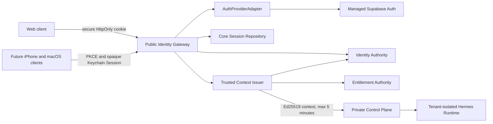

# Identity Runtime and Public Auth v1 Design

**Status:** Approved design; implementation not started
**Date:** 2026-08-10
**Primary surfaces:** B2B consultant Web, B2C student Web
**Future surfaces:** iPhone and macOS clients

## 1. Decision record

The approved product and architecture decisions are:

1. Public authentication is included before MCP, Skill, Composite Memory, or
   irreversible business tools are exposed.
2. The platform uses one shared public Identity Gateway. A company still owns one
   isolated Hermes Runtime container and persistent volume; it does not own a separate
   authentication deployment.
3. Managed Supabase Auth is the first `AuthProviderAdapter`. It authenticates email
   and password or Sign in with Apple, but it is not the authority for Tenant,
   Membership, Profile, role, Entitlement, or Capability.
4. Core-Agent PostgreSQL owns stable `actor_id` values and every business identity and
   authorization fact. A provider subject is replaceable authentication metadata.
5. Web uses an opaque, secure, HttpOnly Core-Agent Session Cookie. Native Apple clients
   use PKCE and store only the opaque Core-Agent Session secret in Keychain. Supabase
   tokens never enter Hermes, the Control Plane, logs, events, or public contracts.
6. B2C students may self-register. B2B company administrators and consultants may only
   join through an invitation.
7. A normal human Actor belongs to exactly one B2B Tenant or one B2C Tenant. B2B and
   B2C identities are mutually exclusive. Platform super administrators are the only
   humans with authority across multiple B2B Tenants.
8. `platform_super_admin` is a platform role, not an alias for a customer-company
   administrator. Its real Actor identity is preserved in every request and audit
   event. It cannot silently impersonate a company administrator or consultant.
9. Platform super administrators have permanent, system-managed administrator
   Memberships in every B2B Tenant. Customer administrators cannot edit or revoke
   those Memberships.
10. A company administrator has management access only by default. Agent use requires
    an explicit `consultant` role, a consultant Profile, and the corresponding Pack
    seat assignment.
11. The first release requires verified email but does not enable MFA. Platform and
    company administration actions require password reauthentication within the last
    ten minutes. Irreversible external writes remain unavailable until a later Human
    Approval and stronger-authentication milestone.
12. Identical verified email identities may use Supabase automatic linking. An Apple
    identity with a different address, including an Apple private relay address, may
    only be linked while the user is already authenticated and has reauthenticated.
13. A B2C registration creates its Actor, personal Tenant, student Membership, and
    one default Profile, but does not create a Hermes Runtime. Runtime creation waits
    for the first active Entitlement defined by the companion Entitlement design.
14. Account deletion immediately revokes access and begins a thirty-day recovery
    period. At expiry, authentication PII is deleted and retained audit identity is
    pseudonymized. Container-volume deletion remains a separate explicit operation.

## 2. Context and problem

Runtime v1 deliberately exposes only a private Control Plane and a loopback synthetic
Web client. The existing `IdentityGraph`, `TrustedRequestContext`, and signed-envelope
contracts define the intended wire boundary, but they do not authenticate a human,
verify a cryptographic signature, issue or revoke a public Session, manage invitations,
or own a durable identity authority.

Publishing the current private bootstrap credential as a public login mechanism would
let a browser invent Tenant, Actor, role, Profile, and Entitlement facts. Passing a
Supabase JWT directly through every service would merely replace that problem with a
provider-specific token and would make the later self-hosting migration alter internal
service contracts. This milestone adds one public identity boundary while preserving
the existing private Control Plane.

The next companion specification,
[Entitlement and Capability Registry v1](2026-08-10-entitlement-capability-registry-v1-design.md),
consumes the identity authority defined here. Neither specification exposes a real MCP
tool to Hermes.

## 3. Goals and scope

### 3.1 Goals

- Authenticate B2C students and invited B2B users with verified email/password or
  Sign in with Apple.
- Keep provider identities replaceable while preserving stable Core-Agent Actors.
- Enforce the approved platform, company, consultant, and student role boundaries.
- Create, rotate, revoke, and audit bounded Core-Agent Sessions.
- Cryptographically sign and verify short-lived, request-bound Trusted Context.
- Give Web and future Apple clients one public authentication and Session protocol.
- Support a controlled migration from managed Supabase Auth to a self-hosted provider
  without changing business resource identifiers.
- Provide a recoverable, auditable account-deletion process.

### 3.2 Included

- One public Identity Gateway process with an `AuthProviderAdapter` boundary.
- Managed Supabase email/password and Apple authentication adapters.
- B2C registration and B2B invitation acceptance.
- Identity, provider-subject, platform-role, invitation, Session, and deletion storage.
- Existing Tenant, Actor, Membership, and Profile authority extended with the approved
  invariants.
- Ed25519 Trusted Context issuance, verification, key rotation, and revocation checks.
- Web Session Cookie, CSRF, origin, rate-limit, and reauthentication behavior.
- Native-client PKCE and Keychain contract boundaries without building the native apps.
- Public-safe errors, audit events, deterministic fakes, and opt-in real Supabase
  acceptance.

### 3.3 Excluded

- MFA, phone login, magic-link login, enterprise SSO, SCIM, or passkeys.
- Stripe, App Store purchase, billing, invoices, or webhook processing.
- Real MCP invocation, dynamic Hermes tools, business Skills, or Policy Plugin
  enforcement.
- Composite Memory, Consent authority, student-case data, document upload, or real
  student application content.
- Human Approval and irreversible external writes such as payment, final submission,
  signing, or sending an external message.
- Company deletion, legal-hold policy, regulatory export, or a complete data-retention
  program.
- A native iPhone or macOS implementation.

## 4. Chosen architecture

The Identity Gateway is the only public trust boundary in this milestone. It does not
own Runtime lifecycle or run model requests. The existing Control Plane remains private
and consumes only a verified, server-derived context. Identity, Session, and
Entitlement modules may share the existing PostgreSQL cluster in the first release,
but each has independent repositories, migrations, services, and authorization tests.

## 5. Authority and data model

### 5.1 Existing resources remain canonical

`Tenant`, `Actor`, `Membership`, and `Profile` remain the public identity resources.
The implementation must extend their schema through the existing compatibility and
release process; it must not create provider-specific replacements.

The authority applies these invariants:

- a B2C Tenant has exactly one active student Membership and one default Profile owned
  by that Actor;
- a normal Actor has active or invited Memberships in no more than one Tenant;
- a B2B consultant Profile requires an active Membership containing `consultant`;
- a B2B administrator without `consultant` has no Profile;
- adding `consultant` to an administrator is a separate, versioned write and creates
  the Profile only after its own idempotent command succeeds;
- a customer administrator cannot grant `platform_super_admin`;
- an ordinary Membership cannot reference another Tenant's Actor or Profile.

### 5.2 Provider identities

`auth_subjects` stores only replaceable authentication identity:

| Field | Rule |
| --- | --- |
| `auth_subject_id` | Core-Agent opaque identifier |
| `actor_id` | Stable internal Actor reference |
| `provider` | Closed adapter identifier, initially `supabase` |
| `provider_subject` | Provider user identifier, unique with `provider` |
| `provider_identity_kind` | `email_password` or `apple` |
| `verified_at` | Server-observed verification time |
| `status` | `active`, `unlinked`, or `revoked` |
| metadata | Resource version and timestamps only |

Email address, Apple relay address, password material, provider tokens, and raw provider
claims are not part of ProductEvent, AuditEvent, Trusted Context, or the Actor contract.
If an email is needed for invitations or account recovery, it resides in a private PII
projection with narrower access and a separate deletion path.

Supabase may automatically link identities with the same verified email. Manual Apple
linking with a different email requires an active Core Session, recent password
reauthentication, a one-time state/nonce, and successful provider callback. Linking
never merges two existing Core-Agent Actors automatically; that conflict fails closed
for platform support.

### 5.3 Platform role and permanent cross-company Memberships

`platform_role_assignments` grants `platform_super_admin` to internal platform Actors.
For every active assignment, an idempotent projector creates a system-managed `admin`
Membership in each B2B Tenant. Creating a B2B Tenant includes those Memberships in the
same durable workflow. Granting or revoking the platform role adds or revokes all such
Memberships through bounded jobs.

System-managed Memberships:

- carry `membership_source: platform` in storage and the versioned contract;
- cannot be modified by a company administrator;
- do not consume a consultant or Capability Pack seat;
- do not create a Profile by default;
- preserve the platform Actor as `actor_id` and `original_actor_id`;
- emit tenant-scoped audit records for every customer-company access or mutation.

The first release accepts the risk of permanent platform access because the user chose
that product model. It does not hide the access or label it as customer action.

### 5.4 Invitations and onboarding

Only a platform super administrator may create a B2B Tenant and its first company
administrator invitation. An active company administrator may invite another company
administrator or consultant into the same Tenant. Invitation acceptance is bound to
the normalized verified email selected when the invitation was created; an Apple relay
identity with another address cannot claim it without platform review.

An invitation is single-use, expires after seven days, stores only a digest of its
random secret, and is invalidated when replaced, revoked, accepted, or when the target
Tenant closes. Accepting it atomically activates the Membership and, for a consultant,
creates the consultant Profile. Replays return the same accepted resource; a changed
Actor or email conflicts.

B2C open registration atomically creates one Actor, one personal B2C Tenant, one active
student Membership, and one default Profile. It creates no Entitlement and no Runtime.
Registration failure rolls back the complete identity graph; retry with the same
idempotency identity converges on the first result.

### 5.5 Identity database role

`core_agent_identity` is a login role with schema usage and this exact Task 3-9
matrix; omitted operations are denied:

| Tables | Operations | Purpose |
| --- | --- | --- |
| `tenants`, `actors`, `memberships`, `profiles` | `SELECT`, `INSERT`, `UPDATE` | create and version the identity graph; deletion is state-based |
| `auth_subjects`, `private_identity_pii` | `SELECT`, `INSERT`, `UPDATE`, `DELETE` | provider authority and the Task 9 PII erasure boundary |
| `core_sessions` | `SELECT`, `INSERT`, `UPDATE`, `DELETE` | Session state machine; database guard permits physical deletion only after revocation |
| `platform_role_assignments`, `identity_invitations`, `oauth_transactions`, `account_deletions` | `SELECT`, `INSERT`, `UPDATE` | versioned identity state machines |
| `public_rate_limits`, `idempotency_records` | `SELECT`, `INSERT`, `UPDATE` | atomic counters and durable replay records |
| `product_events`, `audit_events`, `outbox` | `SELECT`, `INSERT` | immutable append and delivery enqueue only |
| `stream_sequences` | `SELECT`, `INSERT`, `UPDATE` | transactional sequence allocation |
| `worker_jobs` | `SELECT`, `INSERT` | enqueue the two closed identity job kinds; Worker owns claims and outcomes |

The role has no access to schema migrations, Runtime/container, Conversation,
Session/Run/message, secret-reference, or stream-cursor tables. `core_agent_app`
continues to have no access to the eight private identity tables.

## 6. AuthProviderAdapter

The adapter surface is provider-neutral and returns allowlisted authentication facts.
It supports:

- email/password sign-up with mandatory email verification;
- email/password sign-in;
- Apple authorization start and callback with state, nonce, PKCE, and exact redirect
  allowlists;
- current provider-subject verification;
- password reauthentication;
- identity linking while authenticated;
- provider Session revocation and password reset initiation.

The adapter never returns a provider error body, password, refresh token, Apple token,
or arbitrary metadata to a route handler. Failures map to a small internal vocabulary:
`AUTH_INVALID`, `AUTH_EMAIL_UNVERIFIED`, `AUTH_RATE_LIMITED`,
`AUTH_PROVIDER_UNAVAILABLE`, `AUTH_CALLBACK_INVALID`, and `AUTH_CONFLICT`.

The managed Supabase implementation is an adapter, not the domain model. A later
self-hosted adapter creates a new `auth_subjects` row pointing at the existing
`actor_id`; the cutover revokes all Core Sessions and requires login again. Tenant,
Membership, Profile, Conversation, Entitlement, audit, and Runtime identifiers do not
change.

## 7. Core Sessions and client transport

### 7.1 Session secret

After successful provider authentication, Identity Gateway creates a 256-bit random
opaque Session secret. The client receives the secret once. PostgreSQL stores only its
cryptographic digest plus:

- `session_id`, `actor_id`, provider subject reference, and client kind;
- creation, last-seen, idle-expiry, absolute-expiry, and reauthenticated-at times;
- status `active`, `revoked`, or `expired`;
- bounded device label and server-derived security metadata;
- resource version and revocation reason code.

The default idle lifetime is seven days and the absolute lifetime is thirty days.
Successful bounded use may advance idle expiry but never absolute expiry. Password
reset, account disablement, deletion request, provider unlink, or explicit sign-out
revokes the relevant Core Sessions immediately.

### 7.2 Web

Web stores the opaque secret in a `Secure`, `HttpOnly`, `SameSite=Lax` Cookie with an
exact host and path. OAuth callback compatibility is the reason for `Lax` rather than
`Strict`. State-changing requests require an allowlisted `Origin`, an independent CSRF
token bound to the Session, JSON content type, and the existing bounded body policy.
The browser never reads either the Core Session secret or a Supabase token.

### 7.3 Apple clients

Future iPhone and macOS clients use native Sign in with Apple and PKCE. The Identity
Gateway receives the provider proof, creates the same Core Session resource, and
returns its opaque secret over TLS. The native client stores that secret in Keychain.
No Apple client depends on a Web Cookie, and no native-specific identity fields enter
the authority model.

### 7.4 Reauthentication and rate limits

Platform and company management, invitations, Membership role changes, Session
management, Entitlement grant/revoke, Profile assignment, identity linking, and account
deletion require `reauthenticated_at` within ten minutes. The first release satisfies
reauthentication with the current password; an Apple-only account must add a verified
password before it may perform those actions.

Login, sign-up, password reset, invitation acceptance, Apple callback, and
reauthentication have independent account/IP/device rate limits. Public errors do not
reveal whether an email, invitation, Actor, or Tenant exists.

## 8. Trusted Context issuance and verification

The existing `SignedTrustedRequestContext` transport becomes cryptographically real.
Identity Gateway issues a context only after it has:

1. validated the Core Session and current Actor status;
2. selected one exact active Membership and Profile;
3. loaded current Tenant and platform authority;
4. consumed an immutable effective Entitlement Snapshot from the companion service;
5. bound the exact Conversation, Run, request, trace, issuer, and audience facts; and
6. canonicalized the payload before Ed25519 signing.

The context lifetime is at most 300 seconds, matching the existing contract. Context
issuance does not make it valid forever: every consumer verifies the signature,
`key_id`, issuer, audience, validity window, Membership, Profile, and current revocation
authority. A later Policy/MCP Gateway must also re-evaluate Entitlement and Consent
before a tool call, and again immediately before any external side effect.

Signing private keys live in the approved SecretStore or production key-management
system, never PostgreSQL. Verifiers select an allowlisted public key by `key_id`.
Rotation publishes the new public key before signing with it and retains the old public
key for longer than the maximum context lifetime. Unknown, disabled, or ambiguous keys
fail closed.

## 9. Public and internal APIs

The public route family is `/auth/v1`. Exact request and response schemas belong in
`@core-agent/contracts` and remain free of provider tokens and business secrets.

| Route family | Purpose |
| --- | --- |
| email sign-up/sign-in/verification/reset | B2C registration and existing-user login |
| Apple start/callback/link | Web and native Apple identity flows |
| Session inspect/sign-out/revoke | Current Session and device management |
| reauthenticate | Establish the ten-minute management window |
| invitation inspect/accept/revoke | B2B invitation lifecycle without existence leaks |
| B2C onboarding | Create the one personal identity graph |
| platform company administration | Create B2B Tenant and first administrator |
| company member administration | Invite, suspend, or revoke same-Tenant users |
| account deletion request/cancel | Thirty-day deletion state machine |

Public routes return stable Error Envelopes and calm client reasons. Provider names,
HTTP bodies, internal hostnames, stack traces, key identifiers, and Tenant existence do
not appear in user-facing text.

## 10. Failure behavior

- If Supabase is unavailable, new login, linking, reset, and reauthentication fail with
  a bounded temporary error. Existing Core Sessions remain usable within their own
  lifetime but cannot be extended through provider activity.
- If Identity Authority, Session storage, current Membership, Profile, or signing-key
  authority is unavailable or inconsistent, protected access fails closed.
- If a provider callback has invalid state, nonce, PKCE, issuer, audience, or redirect,
  no Actor, subject, or Session is created.
- If provider identity linking would join two existing Actors, the operation is denied
  and creates a redacted platform-support audit event.
- If invitation activation races suspension or revocation, the versioned authority
  write decides one outcome; no second Membership or Profile is created.
- A stale Cookie or native Session secret is indistinguishable from an unknown Session
  to the client.

## 11. Account deletion

Deletion uses `active -> deletion_pending -> deleted`.

Requesting deletion atomically disables new Session creation, revokes current Sessions,
marks the Actor pending deletion, revokes its ordinary Memberships and Entitlements,
and issues the appropriate Runtime stop intent. The recovery deadline is exactly thirty
days from the authoritative database clock. Recovery requires successful provider
authentication and recent password reauthentication before the deadline.

At expiry:

- the finalizer deletes every revoked Core Session for the Actor/AuthSubject before
  deleting the AuthSubject and private PII in the same serializable transaction;
- an active or expired Core Session is never physically deleted: it must first make
  the immediate, durable transition to `revoked`, and any finalization failure rolls
  back the Session, AuthSubject, and PII deletions together;
- provider-subject links and private authentication PII are deleted;
- the Supabase user is removed through an idempotent background job;
- B2C-owned personal resources enter the later retention/deletion workflow;
- a B2B user's Membership and Profile remain revoked, while company-owned business
  history is retained and the Actor reference is pseudonymized;
- audit records retain non-PII identifiers and decision history;
- Hermes Volume deletion remains a separately authorized, auditable command.

Company deletion and legal retention are not inferred from a user's deletion request.

## 12. Security and privacy boundaries

- No password, provider token, Session secret, Cookie, Apple code, email address, or
  raw OAuth claim may appear in ProductEvent, AuditEvent, application logs, database
  error summaries, traces, or model prompts.
- Core-Agent never authorizes from Supabase `user_metadata`, JWT role claims, browser
  fields, or model output.
- Normal users are single-mode and single-Tenant. Platform Memberships are
  system-managed and visibly platform-originated.
- No MFA is an explicitly accepted first-release limitation. Without MFA, the platform
  does not enable irreversible external writes, payments, final submissions, signing,
  or outbound communication.
- Identity production readiness does not authorize real student documents or case
  content. Consent, Retention, and Data Governance require later accepted specs.
- Apple Web OAuth secret rotation is an operational release requirement; a missed
  rotation must fail login, never bypass Apple verification.

## 13. Verification and acceptance

The implementation is accepted only when:

1. B2C email/password registration creates one Actor, personal Tenant, active student
   Membership, and default Profile with no Runtime.
2. B2B self-registration is impossible; invitation acceptance creates only the exact
   intended same-Tenant Membership and consultant Profile when applicable.
3. normal Actors cannot hold B2B and B2C Memberships or join multiple Tenants.
4. platform super administrators receive immutable platform-origin Memberships in all
   B2B Tenants, preserve their real Actor identity, and generate tenant audit events.
5. company administrators cannot cross Tenant boundaries or alter platform Memberships.
6. company administrators have no Agent Profile unless explicitly granted consultant
   role and seat authority.
7. Supabase subjects map to stable Actors and provider replacement leaves every
   business identifier unchanged.
8. Session Cookies, CSRF, Origin, PKCE, state, nonce, idle expiry, absolute expiry,
   reauthentication, reset, and revocation tests pass.
9. Ed25519 signing, tamper rejection, issuer/audience checks, 300-second maximum TTL,
   key rotation, and unknown-key rejection pass.
10. concurrent invitation, Session, role, and deletion operations converge without
    duplicated authority or partial rows in real PostgreSQL tests.
11. public authentication errors do not enumerate accounts, invitations, or Tenants.
12. account deletion immediately revokes access, permits recovery for thirty days, and
    performs bounded PII deletion without deleting company data or a Volume implicitly.
13. deterministic fake-provider unit, integration, and browser tests pass in CI.
14. an opt-in, non-sensitive real Supabase email/password and Apple acceptance passes
    before public deployment.
15. credential, provider-token, Cookie, PII, log, event, and database sentinel scans
    find no leakage.

## 14. Rollout and rollback

Rollout begins behind a public-auth feature flag while the current loopback synthetic
Web path remains available. Database changes are forward-only. Identity Gateway is
deployed before any public route is advertised; no Control Plane port becomes public.

Rollback disables public route admission and Session issuance, revokes Sessions issued
by the failed release if their semantics changed, and restores the earlier Gateway
binary. Stable Actors, Tenants, Memberships, Profiles, provider-subject links, and audit
history remain. A provider migration retains both mappings during an explicit rollback
window and never rewrites business foreign keys.

Completion of this specification permits implementation of the companion Entitlement
specification. It does not permit MCP execution or real student-case data.
