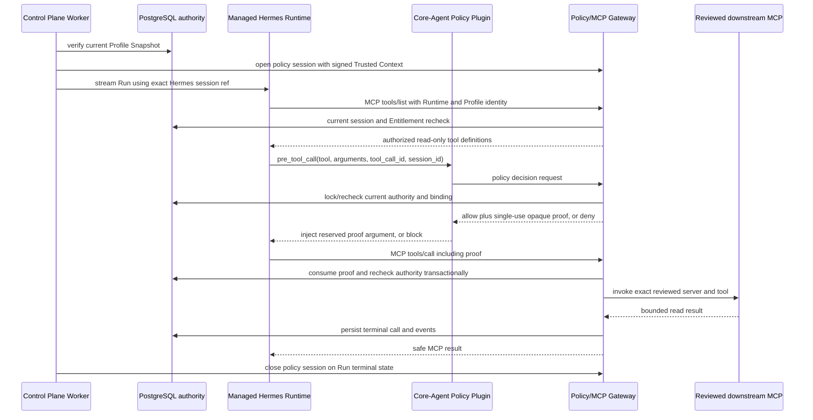

# Policy Plugin and Capability/MCP Gateway v1 Design

**Status:** Implemented; deterministic acceptance passed in two consecutive command invocations (four clean attempts); managed Runtime acceptance `NOT_RUN` because the Docker daemon was unavailable
**Date:** 2026-08-25
**Depends on:** [Entitlement and Capability Registry v1](2026-08-10-entitlement-capability-registry-v1-design.md)
**Next phase:** Composite Memory authority, then EduApply read-only MCP onboarding

## 1. Decision record

The approved product and architecture decisions are:

1. Core-Agent adds a dedicated private Policy/MCP Gateway outside the Hermes process.
   The Gateway, PostgreSQL authority, and reviewed platform configuration make the
   final allow/deny decision; prompts, model output, Hermes memory, and plugin state
   never grant authority.
2. The managed Hermes image adds a product-owned `pre_tool_call` plugin. The plugin
   asks the Gateway for a decision and injects a short-lived single-use execution
   proof into an allowed MCP call. It blocks on denial, timeout, malformed replies,
   or any exception.
3. The Gateway independently requires, validates, and transactionally consumes the
   proof before every downstream call. A missing or failed plugin therefore cannot
   create a bypass.
4. A Worker opens a policy session immediately before a Run enters Hermes and closes
   it when the Run terminates. The session is bound to exact Tenant, Actor,
   Membership, Profile, Conversation, Core Session, Run, Hermes session reference,
   Entitlement Snapshot, and Runtime generation.
5. The Gateway lists only tools backed by a current reviewed MCP Capability Version,
   a current effective Profile Snapshot, and one platform-owned immutable tool
   binding. It does not proxy tools discovered from a customer or model-provided URL.
6. v1 executes only `kind=mcp`, `risk_class=read`, and
   `approval_requirement=none`. Skills, Policies as executable artifacts,
   `draft_write`, `external_write`, `privileged`, confirmation, and Human Approval
   remain denied.
7. Every decision and call uses current database authority. Suspension, expiry,
   revocation, blocked catalog resources, Membership/Profile/Tenant suspension, or
   Snapshot replacement invalidates future decisions and unconsumed proofs.
8. Downstream MCP services remain separate versioned products. This milestone builds
   the generic Gateway and a deterministic test service; it does not copy EduApply or
   expose real student/customer data.
9. The managed Runtime may contact only the dedicated Gateway ingress and existing
   provider egress. It never receives database credentials, platform signing keys,
   downstream MCP credentials, or a general control-plane route.
10. A downstream read may finish after dispatch if authority changes concurrently,
    but its result is recorded against the consumed authority. Future write support
    must add an immediate pre-effect recheck and Human Approval; this design does not
    authorize writes.

## 2. Context and problem

The Entitlement and Capability Registry produces a current immutable Capability set
and projects it into a managed Runtime, but intentionally leaves Hermes without MCP
servers or business tools. Merely inserting a tool definition into Hermes would not
be authorization: the model could attempt an unlisted tool, stale Runtime state could
outlive a revocation, a plugin could fail, and a compromised Runtime could call a
downstream service directly.

Core-Agent therefore needs a reference monitor between Hermes and every business
capability. It must preserve Profile/Tenant isolation, bind calls to the current Run,
reject stale Entitlements at call time, prevent replay and argument substitution, and
produce an auditable lifecycle without importing domain application code.

## 3. Goals and scope

### 3.1 Goals

- Expose a standards-compatible private MCP surface to managed Hermes Runtimes.
- Resolve tool visibility from current Profile Entitlement authority.
- Enforce a deterministic v1 policy outside model input.
- Bind every executable call to one current Run and exact canonical arguments.
- Make execution proofs short-lived, opaque, single-use, and transactionally consumed.
- Route only to reviewed immutable platform bindings.
- Record policy decisions and the requested/started/succeeded/failed Tool lifecycle.
- Integrate without modifying vendored Hermes source.
- Provide real PostgreSQL, HTTP, MCP, plugin, Worker, security, and deterministic
  Runtime acceptance evidence.

### 3.2 Included

- Contracts 0.9.0 for policy sessions, decisions, proofs, bindings, and safe outcomes.
- Database schema 16 for immutable Policy versions and MCP tool bindings, active
  policy sessions, decisions, execution proofs, and call records.
- One built-in, versioned read-only policy evaluator.
- A dedicated `apps/policy-mcp-gateway` private service.
- MCP `initialize`, `tools/list`, and `tools/call` over Streamable HTTP.
- A product-owned Hermes `pre_tool_call` plugin and managed-image configuration.
- Worker policy-session admission and terminal closure around Hermes Runs.
- Runtime/Supervisor projection of a non-secret Gateway origin and Runtime identity.
- A deterministic fake downstream MCP invocation port for acceptance.
- Operational runbooks, security checks, and rollback.

### 3.3 Excluded

- EduApply, IELTS, housing, auto-apply, marketing, or another domain implementation.
- Real student/customer records, Composite Memory, Consent, Retention, or Data
  Governance.
- Skills or Policy artifact execution inside Hermes.
- Draft or external writes, irreversible effects, approval queues, Human Approval,
  payments, usage billing, or marketplace publishing.
- Customer-authored policy, customer-selected endpoints, arbitrary URLs, dynamic code
  download, tool discovery from unreviewed servers, or runtime-installed plugins.
- Public Internet access to the Gateway, browser access to the MCP endpoint, or a
  customer-facing administration UI.

## 4. Architecture

### 4.1 Why a dedicated Gateway

Three placements were considered:

| Placement | Decision | Reason |
| --- | --- | --- |
| Patch Hermes core | Rejected | Couples the product to upstream internals and places final authority in a model-facing process. |
| Put MCP proxying in Control Plane API | Rejected | Expands the public/control-plane blast radius and couples browser traffic to tool execution. |
| Dedicated private Gateway | Selected | Creates a narrow reference monitor with its own credentials, limits, health, audit, and rollback. |

The Gateway may use shared Runtime Core libraries, but it runs as a separate
least-privilege process and owns no public routes.

### 4.2 Defense in depth

The plugin is useful for early denial and proof injection, but is not a trusted
enforcement boundary. Hermes currently treats plugin hook exceptions defensively at
the agent layer, so the Gateway must assume calls can arrive without the hook. Every
`tools/call` therefore requires a valid proof that only the Gateway can issue and
consume. Reserved proof input is overwritten by the plugin and rejected if supplied
by a model before that overwrite.

## 5. Authority model

### 5.1 Policy version

`core-agent-read-mcp-v1` is an immutable built-in Policy Version with exact rules:

- Tenant, Membership, Profile, Session, Run, Snapshot, and Runtime must be current.
- Capability Version status is `reviewed`.
- Capability kind is `mcp`.
- Risk class is `read`.
- Approval requirement is `none`.
- The exact Capability Version appears in the current Profile Snapshot.
- One published immutable MCP Tool Binding references the same Capability Version.
- The requested public tool name and binding version match exactly.
- Canonical arguments satisfy the reviewed input schema and configured byte/depth
  limits.
- No reserved Core-Agent field is present in model arguments.

Unknown policy versions, fields, decision branches, capability kinds, risks,
approvals, tools, and binding states deny by default. Model output cannot select a
policy version.

### 5.2 MCP server and tool bindings

Platform configuration defines immutable global resources:

- `mcp_server_version_id`, stable server family, canonical semantic version, exact
  private HTTPS origin, protocol version, credential reference ID, server identity,
  response/time limits, and status;
- `mcp_tool_binding_id`, exact Capability Version, server version, downstream tool
  name, public tool name, reviewed input schema, schema hash, output contract
  reference, and status.

Draft bindings are not executable. Publication requires the Capability Version to be
reviewed, MCP/read/none, the origin to be an allow-listed private HTTPS origin, tool
names to be canonical and unique, schemas to pass bounded closed-object validation,
and credential references to remain opaque. Published rows are immutable; retirement
prevents new sessions, while blocking immediately denies future decisions.

Tenant, browser, model, plugin, Runtime, and downstream service input cannot create or
select a binding. The first implementation bootstraps one deterministic internal
acceptance binding; real domain binding publication is a separate reviewed operation.

### 5.3 Current Entitlement authority

The Gateway reuses `requireCurrentSnapshotAuthority`. Exactness includes the current
Profile pointer, Snapshot ID/version/hash, sorted Capability triples, active source
Entitlements/Assignments/Releases, reviewed/non-blocked catalog resources, and ready
Runtime generation. A signed Trusted Context is admission evidence, not a cache that
overrides the current database.

## 6. Policy session lifecycle

### 6.1 Open

Immediately before the Worker opens the Hermes stream it submits:

- the signed Trusted Context envelope;
- exact `run_id`, `conversation_id`, Core `session_id`, Hermes `session_ref`;
- exact Runtime container ID and generation;
- request/trace/correlation IDs;
- a stable Worker idempotency key.

The Gateway verifies the signature, issuer, audience, TTL, trusted-context linkage,
current Membership/Profile/Session/Run, and current Snapshot authority. It writes one
active policy session with a database-clock expiry no later than the earliest trusted
context, Core Session, or Run deadline. Replaying the identical command returns the
same session; reusing the key or Hermes session reference with different facts
conflicts.

Only one active Run policy session may own a `(runtime_id, hermes_session_ref)` pair.
The Gateway returns no bearer credential to the model or browser. Runtime/Profile
identity headers select a candidate session only; the proof remains the call
authorization.

### 6.2 Use

`tools/list` resolves the one active session from exact Runtime ID, Profile reference,
and Hermes session reference, then rechecks current authority. It emits only reviewed
tool definitions permitted by the current Snapshot and policy. Results are sorted by
public tool name and contain no internal IDs, endpoint, credentials, Entitlement
reason, or customer data.

The plugin decision endpoint additionally requires exact Run session identity from
its locally projected configuration and hook context. It never accepts Tenant,
Profile, Snapshot, or policy selection from model arguments.

### 6.3 Close and expiry

The Worker closes the policy session after succeeded, failed, or cancelled Run
terminal persistence. Closure invalidates unconsumed proofs. A sweeper expires
abandoned sessions and proofs using database time. Failure to close is safe because
expiry and current Run authority still deny future calls.

## 7. Decision and execution proof

### 7.1 Canonical request

The plugin sends the exact public tool name, arguments, Hermes `tool_call_id`, and hook
session ID. The Gateway:

1. parses a plain JSON object with no accessors, prototypes, duplicate decoded keys,
   non-finite numbers, binary values, or unsupported JSON values;
2. rejects the reserved `__core_agent_policy` key;
3. applies strict aggregate byte, depth, node, property, array, and string limits;
4. validates the reviewed binding schema without coercion or defaults;
5. computes a versioned canonical JSON SHA-256 argument hash.

### 7.2 Decision

An immutable decision record contains IDs and hashes only: policy session, Run,
Capability Version, binding, policy version, tool-call ID, argument hash, allow/deny,
closed reason code, and timestamp. It contains no raw arguments, downstream result,
prompt, customer content, or secret.

Allowed decisions return an opaque random proof with at least 192 bits of entropy.
Only a keyed digest is stored. The proof is bound to the decision, exact arguments,
tool-call ID, tool binding, session, Run, Snapshot, Runtime, policy version, and an
expiry of at most 30 seconds. A duplicate identical decision request returns the same
logical decision but rotates no new proof after the original is consumed.

### 7.3 Consumption

`tools/call` passes the proof only through the reserved argument. The Gateway strips
it before schema validation and downstream dispatch. In one transaction it locks the
proof, rejects expired/used/closed/mismatched facts, rechecks all current authority,
marks it consumed, and creates a `requested` call record. Concurrent replays have one
winner. A consumed proof is never restored, including after downstream failure.

The downstream invocation happens after the consume transaction. The Gateway records
`started`, followed by exactly one `succeeded` or `failed` terminal state. This is a
read-only at-most-once dispatch boundary, not a distributed exactly-once guarantee.

## 8. MCP transport and downstream adapter

The private endpoint supports the negotiated MCP protocol required by the vendored
Hermes release and only these operations:

- `initialize` with fixed server identity and supported protocol;
- `notifications/initialized`;
- `tools/list` with no pagination in v1 and a maximum of 128 authorized tools;
- `tools/call` with one reviewed public tool name and arguments.

Batch requests, resources, prompts, sampling, roots, subscriptions, arbitrary
notifications, server-initiated calls, unknown protocol versions, and unknown methods
are rejected. Request bodies, headers, results, and timeouts are bounded. Errors use
calm MCP-safe messages and stable internal reason codes without leaking existence
across Tenants.

The `McpInvocationPort` receives only the platform-selected server binding,
downstream tool name, validated arguments, safe trace IDs, and a bounded abort signal.
It resolves credentials from the Gateway secret store and never returns them. The
test implementation is deterministic and in-process. A future remote implementation
must pin TLS, prevent redirects and DNS rebinding, validate response contracts, and
apply the same outbound allow-list; that remote adapter is not enabled in v1.

## 9. Hermes integration

### 9.1 Product-owned plugin

`infra/hermes/plugins/core-agent-policy` is copied into the product image and enabled
from managed config. Its `pre_tool_call` hook:

- acts only on Gateway MCP tools;
- derives `session_id`, `tool_call_id`, tool name, and exact arguments from trusted
  hook inputs;
- calls the fixed Gateway policy endpoint using a projected Runtime identity secret;
- enforces a short timeout and bounded response;
- returns `block` for any exception, denial, malformed result, or missing identity;
- returns `modify` with the original arguments plus an overwritten reserved proof for
  allow.

It logs only reason codes, call IDs, and trace IDs. It does not log arguments, proofs,
prompts, or results. It cannot configure an endpoint from Profile/model input.

### 9.2 Managed MCP configuration

Hermes sees one platform MCP server named `core_agent_gateway`. The configuration uses
the fixed private Gateway ingress, a non-secret Runtime ID, the active Profile identity
header supported by Hermes, and a per-Runtime secret identity header. No downstream
server appears in Hermes configuration.

The Runtime capability manifest remains a non-secret projection and is not a bearer
credential. Runtime identity secrets are versioned, file-projected, readable only by
the managed UID, and revocable without image rebuild.

## 10. Runtime and network boundary

The Gateway service runs on the internal control network with database and secret-store
access. A narrow Gateway ingress runs on `core-agent-backplane`, forwards only to the
Gateway port, has no database/secret volume, and is not host-published. Dynamic Runtime
containers already join their private Tenant network and `core-agent-egress`; they are
also connected to `core-agent-backplane` only for the fixed Gateway ingress. The
Supervisor validates the exact network set, identity mounts, environment, labels, and
read-only container contract.

The Gateway downstream adapter runs from the Gateway process through an explicitly
configured service network. Runtime containers cannot reach downstream MCP addresses
directly. The public API ingress remains separate and host-only.

If a production topology cannot provide distinct ingress and downstream routes, the
Gateway fails readiness; it must not fall back to arbitrary Internet proxying.

## 11. Database model

Schema 16 adds:

- `policy_versions`: immutable built-in policy ID, version, canonical rule hash,
  status, and review metadata;
- `mcp_server_versions`: immutable reviewed server binding metadata and limits;
- `mcp_tool_bindings`: immutable Capability/server/tool/schema bindings;
- `policy_sessions`: Tenant-scoped current Core Session/Agent Session/Run binding,
  expiry, state, signed effective role, exact Runtime generation, and exact authority
  references;
- `policy_decisions`: append-only allow/deny facts and hashes;
- `policy_execution_proofs`: proof digest, exact bindings, expiry, and one-way state;
- `mcp_tool_calls`: requested/started/terminal lifecycle and safe failure/result
  metadata.

Foreign keys include `tenant_id` for every tenant resource. Published global policy,
server, and binding rows cannot be updated or deleted. Decisions and calls are
append-only except for database-enforced one-way state transitions. Initial states,
immutable facts, transition edges, and resource-version increments are validated by
named triggers even for direct application-role SQL. Temporal constraints additionally
require session/proof/call timestamps to follow creation and request order; consumed
proofs cannot be backdated or consumed after their expiry.
Indexes support exact active-session lookup, expiry sweep, proof digest lock, Run
audit, and capability binding resolution. Database constraints cap all IDs, hashes,
status vocabularies, and safe summaries.

Raw arguments and downstream results are never stored in authority/audit tables. The
normal assistant message stream may persist a model-composed reply under its existing
data policy; that is separate from tool authorization evidence.

## 12. Audit and events

Every attributable session open/close, decision, proof consumption, and tool terminal
outcome records the real Actor/Membership, Tenant/Profile/Run, policy version, exact
Entitlement Snapshot ref, decision/outcome, request/trace IDs, and a safe closed reason.
An authentication attempt that safely matches a stored session but presents the wrong
Runtime identity records a denial audit without disclosing that session. A request that
cannot be attributed to any session fails closed without fabricating Actor/Membership
audit facts.

Existing ProductEvent Tool branches are emitted transactionally:

- `tool.requested` after proof consumption;
- `tool.started` immediately before adapter invocation;
- `tool.succeeded` after bounded output validation;
- `tool.failed` for timeout, downstream, response-contract, or internal failure.

No event contains proof material, arguments, result content, endpoint, credential
reference, prompt, customer/student content, or internal exception. Policy-specific
events add only lifecycle IDs, decision, reason code, policy version, and resource
version.

## 13. Failure semantics

The external MCP surface uses one calm denial result for authorization failures.
Internal audit distinguishes closed reasons including:

- `SESSION_NOT_ACTIVE`
- `CURRENT_AUTHORITY_CHANGED`
- `CAPABILITY_NOT_EFFECTIVE`
- `POLICY_NOT_PERMITTED`
- `TOOL_NOT_BOUND`
- `ARGUMENTS_INVALID`
- `PROOF_INVALID`
- `PROOF_EXPIRED`
- `PROOF_REPLAYED`
- `DOWNSTREAM_UNAVAILABLE`
- `DOWNSTREAM_CONTRACT_INVALID`

Gateway/database/plugin unavailability denies tool use but does not corrupt the Run.
Hermes can tell the user the tool is temporarily unavailable. Repeated client retries
with a consumed proof remain denied; a fresh model tool call requires a new tool-call
ID and decision.

## 14. Security and privacy invariants

- No browser/client field grants Tenant, Profile, Capability, policy, binding, server,
  or endpoint authority.
- No model-controlled field carries a trusted internal ID except the public tool name
  and validated tool arguments.
- Plugin and Runtime identities are scoped to one exact Tenant, Runtime container, and
  generation; Runtime identity is additionally scoped to one Profile. They never
  select a session or replace current DB authority.
- Every decision, listing, proof consumption, and dispatch-boundary check revalidates
  Tenant, Actor, Membership, Profile, Conversation, Run, Agent Session, Core Session,
  Runtime generation/health, and current immutable Snapshot authority.
- Proofs are secret, short-lived, digest-stored, single-use, and redacted from all
  logs/errors/events. Proof consumption and the corresponding requested call record
  commit in one transaction.
- Tenant and Profile mismatches return indistinguishable denial.
- Tool schemas are reviewed platform artifacts; schemas cannot execute code, resolve
  references over the network, coerce values, or expose secrets.
- Tool and response limits prevent oversized JSON, depth, node, string, collection,
  timeout, connection, and concurrency exhaustion.
- Gateway routes reject CORS, cookies, browser auth, forwarded identity headers,
  redirects, and untrusted proxy metadata.
- The Gateway has no model-provider key. Hermes has no Gateway database/downstream
  credential. The ingress has neither.
- Audit/log scrubbing tests cover credential-shaped values, proof values, argument
  fixtures, customer/student-like text, and raw exception messages.

## 15. API surfaces

Private Worker routes:

- `POST /v1/policy-sessions/open`
- `POST /v1/policy-sessions/:policy_session_id/close`

Private plugin route:

- `POST /v1/policy-decisions`

Private Runtime MCP route:

- `POST /mcp`

Operational routes:

- `GET /health` proves process liveness only;
- `GET /ready` proves database migration, built-in policy hash, binding load, secret
  readiness, and downstream-adapter configuration.

All non-health routes require exact private authentication and bounded content types.
Unknown routes and methods fail closed. Platform binding publication remains an
offline/version-controlled bootstrap command in v1, not a public HTTP API.

## 16. Testing and acceptance

Completion requires all of the following:

1. Contract tests reject unknown fields/vocabularies and preserve historical schema
   releases.
2. Migration tests prove empty and 15-to-16 upgrades, immutable publications,
   tenant-scoped keys, expiry, and single-use proof locking on PostgreSQL 17.
3. Pure policy tests cover every allow condition and every denial branch.
4. Concurrent PostgreSQL tests prove exactly one proof consumer wins.
5. HTTP/MCP tests complete a real initialize/list/call exchange through the Gateway.
6. Security tests attempt forged Runtime/Profile/Tenant headers, stale Snapshot,
   blocked Capability/binding, changed arguments, proof replay, reserved-field
   injection, oversized input, unknown method, and log/event leakage.
7. Hermes plugin tests execute real Python hook code for allow, deny, timeout,
   malformed response, and exception paths.
8. Worker integration opens a session, streams one deterministic Run, closes it, and
   proves terminal cleanup without changing the existing model-only path.
9. Managed-image/config tests prove no vendored Hermes source changed and only the one
   Gateway MCP server/plugin is enabled.
10. Runtime/Supervisor tests prove exact networks, mounts, identity rotation, and no
    downstream/database credential exposure.
11. An opt-in local acceptance performs a real managed Hermes read-only tool call when
    a Docker-compatible daemon is available. The driver creates owner-only one-time
    identities and keys before Compose, starts the narrow Gateway ingress, bootstraps
    the reviewed synthetic catalog plus B2B Entitlement/Snapshot, waits for the exact
    reconciled Runtime generation, explicitly requests the reviewed tool once, verifies
    call/proof/session/audit evidence, scans for its secret sentinels, and cleans up. If
    Docker is unavailable, the report is explicitly `NOT_RUN`; deterministic acceptance
    must still pass and cannot be presented as live Runtime evidence.
12. Exact Node 22.13.0 unit, type, build, migration, integration, security, formatting,
    and secret-scan gates pass.

## 17. Rollout and rollback

Rollout order is schema migration, built-in policy/bootstrap verification, Gateway,
Gateway ingress, Worker session integration, product Hermes image, then a single
synthetic Profile canary. No real domain binding is published in this milestone.

Feature flags independently disable session opening, tool listing, decisions, and
downstream dispatch. Rollback first disables new sessions and dispatch, drains active
read calls, closes sessions, rolls the Worker/Runtime image back, then rolls the
Gateway process back. Schema 16 remains forward-compatible and append-only; rollback
does not delete decisions or calls. A blocked Policy or binding immediately denies new
decisions without rebuilding Hermes.

## 18. Completion boundary

This milestone is complete when the generic Policy/MCP Gateway, product-owned Hermes
plugin, Worker/Runtime integration, immutable authority, deterministic downstream
adapter, and required acceptance gates pass. It proves that an entitled Profile can
invoke one reviewed synthetic read tool and that all stale/forged/replayed paths deny.

It does not make a real customer-facing business capability available. That requires
the later Composite Memory/data-governance work and a separately reviewed EduApply
read-only MCP contract, binding, consent/data boundary, deployment, and live
acceptance.
